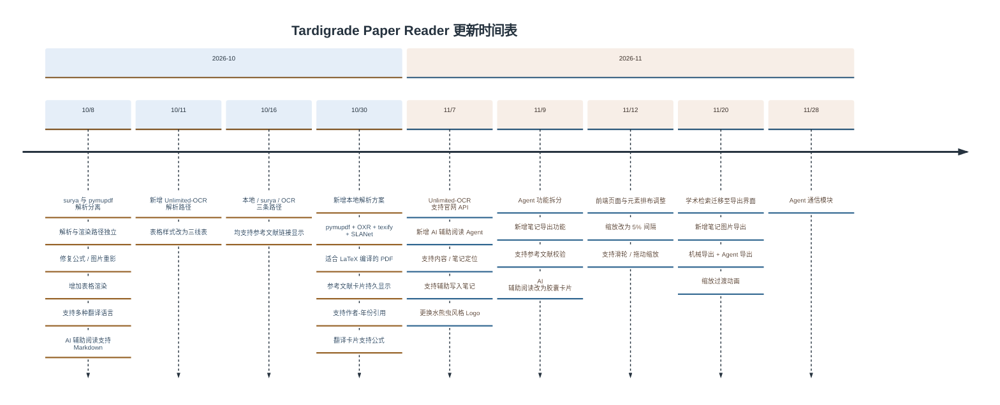
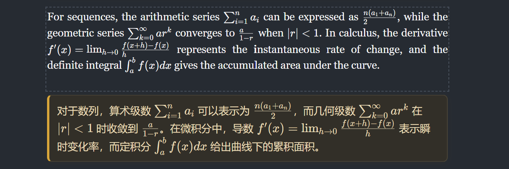
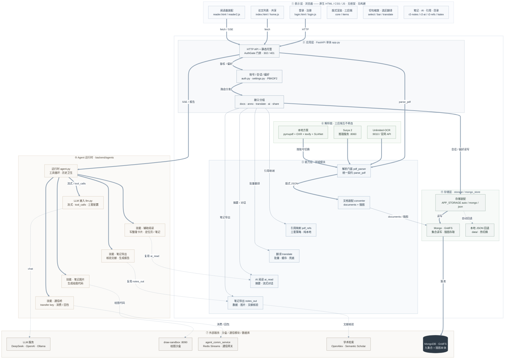
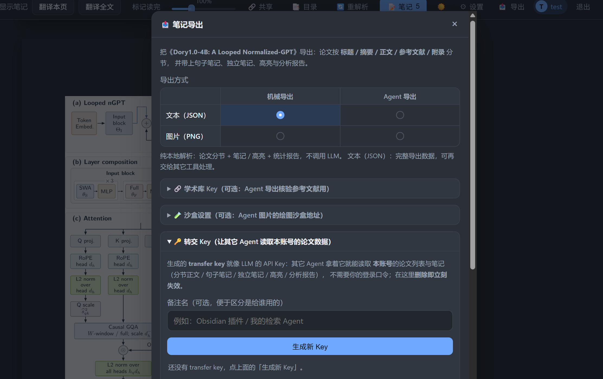
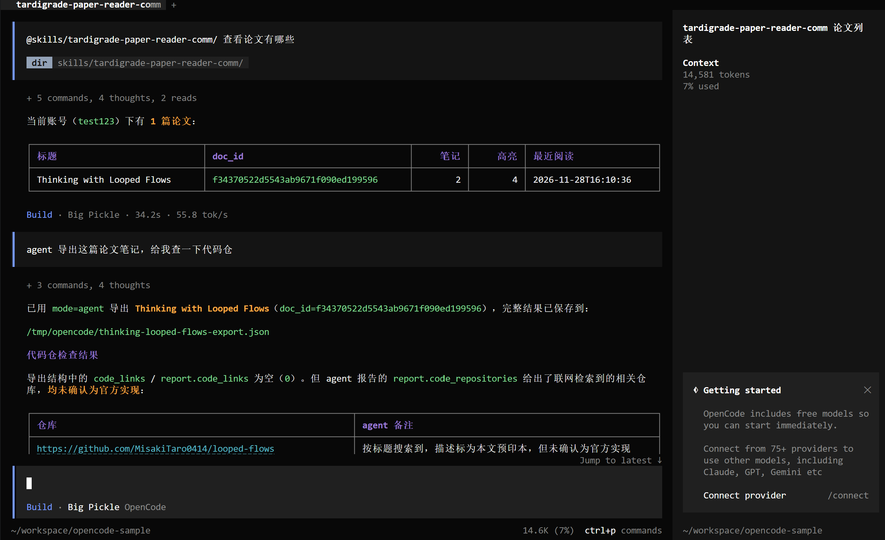
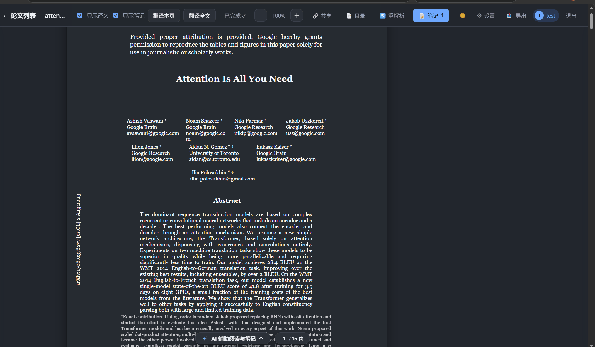
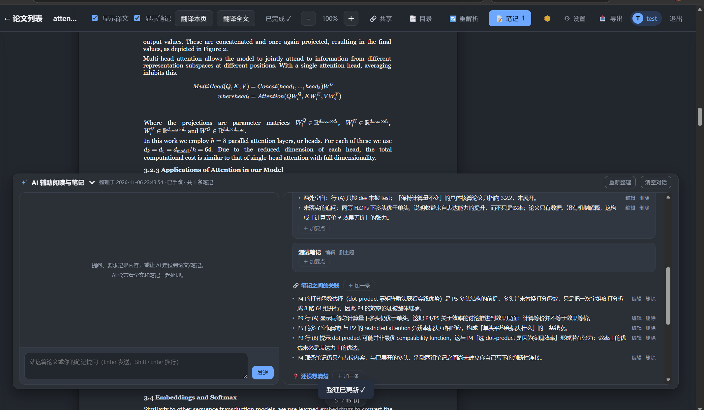
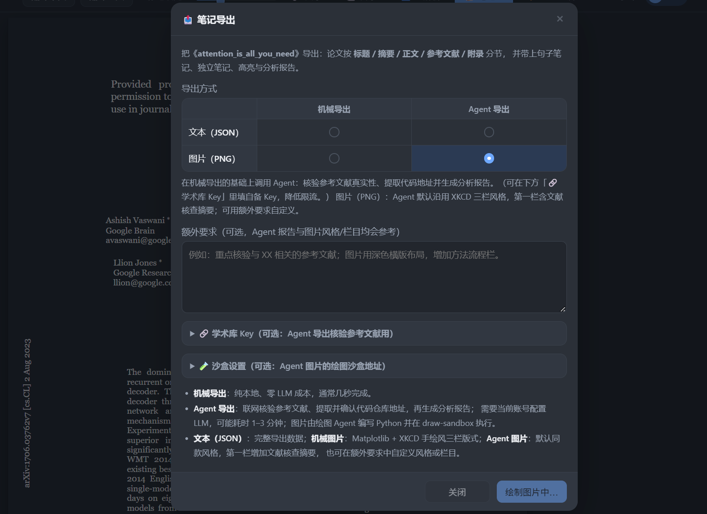
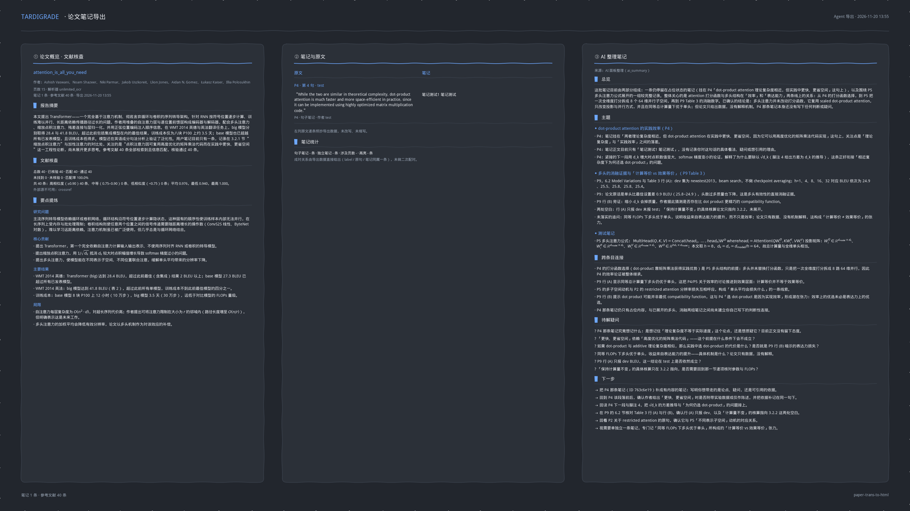
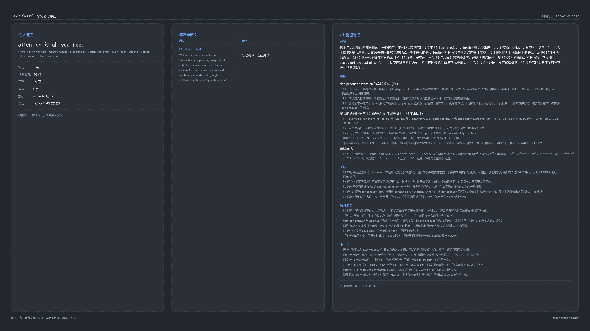

# Tardigrade Paper Reader - Pdf 转 HTML 阅读应用

**简体中文** | [English](./README_en.md)

> AI 辅助工具为 Deepseek-v4-flash/Deepseek-v4.1-flash/GPT-6-Luna + VScode copilot

> 自用，需要者自取

## 更新

📋 查看详细更新说明（点击展开）

1. [26/10/8] surya 解析与pymupdf解析分离，解析pdf和渲染路径独立，解决了surya解析时公式和图片重影问题，增加表格渲染
   
   

    
   

2. [26/10/8] 增加了多种翻译目标语言
   
   

   
   

3. [26/10/8] ai辅助阅读增加 markdown 样式渲染。
4. [26/10/11] 增加 Unlimited-OCR 解析和渲染路径，调整表格渲染样式为三线表。
   
   

5. [26/10/16] 为本地pymupdf解析/surya解析/unlimited-ocr解析增加了参考文献链接显示功能，避免查找繁琐。unlimited-ocr解析不稳定（unlimited-ocr在26/10/14更新后好像没有之前好用了）。
   
   

   

6. [26/10/30] a. 增加本地解析方案，使用pymupdf+OXR的版面分析模型+量化后的texify+SLANet，对latex代码编译的pdf有效；b. 优化参考文献显示功能，信息卡片持久显示和作者-年份引用显示效果；c. 翻译功能，翻译卡片可显示公式。
   
   

7. [26/11/7] a. Unlimited-OCR增加官网api调用；b. 增加ai辅助阅读时的agent功能，可以通过聊天找到论文相关内容/笔记位置 和 帮助写入笔记内容；c. 更换logo（水熊虫三角立体艺术拼接风格）

8. [26/11/9] a. agent功能拆分 b. 增加笔记导出功能（agent分析总结；校验参考文献需要到设置里配置检索api key） c. ai辅助阅读形式更改为底部胶囊卡片（打开收起方式详见功能5）。 

9. [26/11/12] 前端页面显示和元素排布调整，阅读界面缩放改为5%间隔的滑轮缩放/拖动缩放。

10. [26/11/20] a. 学术检索界面迁移到导出界面中，agent合并转为一个agent的skills; b. 增加笔记图片导出功能（机械导出和Agent导出），示例见功能6; c. 增加缩放过度动画，包括论文页/设置和笔记缩进等动作;

11. [26/11/28] 增加 Agent 通信模块。

## 架构设计
架构设计详见 [paper-trans-to-html/README.md](./paper-trans-to-html/README.md)。

## Pdf 解析模块

把论文 PDF 解析成**可还原原版式的数据**（文字块 + 插图，保留原坐标、字号、字体）。提供三种解析方式，输出结构一致，前端无需改动。

<table>
	<thead>
		<tr>
			<th align="center" width="18%">解析方式</th>
			<th align="center" width="24%">依赖与部署</th>
			<th align="center">核心能力</th>
			<th align="center" width="26%">适用场景 / 备注</th>
		</tr>
	</thead>
	<tbody>
		<tr>
			<td align="center"><strong>🖥️ 本地解析</strong> pymupdf + OXR + texify + SLANet</td>
			<td>不依赖显卡和外部服务，装好即用 模型需预先下载，见 <a href="./paper-trans-to-html/backend/pdf_parser/local_parse_pipeline/README.md">local_parse_pipeline/README.md</a></td>
			<td>
				<ul>
					<li>文字按 PDF 原始行框、字号、字体、颜色还原</li>
					<li>自动提取插图（内嵌图片与矢量图表），过滤整页背景、过小贴图</li>
					<li>独立公式与行内公式靠字体识别 + texify 转换</li>
				</ul>
			</td>
			<td>其他方式不可用时的<strong>兜底</strong>；解析 LaTeX 编译生成的 PDF 效果最好</td>
		</tr>
		<tr>
			<td align="center"><strong>📄 Surya</strong> Surya 2 推理服务</td>
			<td>接入服务端版面分析与整页识别 部署方式见 <code>services/surya_doc_parse_service</code></td>
			<td>
				<ul>
					<li>按版面分块还原阅读顺序，插图自动裁剪保存</li>
					<li>表格保留结构，公式识别为 LaTeX 并渲染成数学公式</li>
					<li>电子版论文以原始精确版式为准，扫描件用识别结果还原</li>
				</ul>
			</td>
			<td>电子版与扫描件通用，版面结构还原能力强</td>
		</tr>
		<tr>
			<td align="center"><strong>🔍 Unlimited-OCR</strong> Unlimited-OCR 推理服务 / 官网 API</td>
			<td>本地服务部署见 <code>services/unlimited_ocr_service</code>；本地部署不存在时自动切换官网 API API 需在百度智能云平台创建应用，配置 <code>config.json</code> 中 <code>unlimited_ocr_online_api_key</code> 和 <code>unlimited_ocr_online_secret_key</code></td>
			<td>
				<ul>
					<li>Unlimited-OCR 模型做版面分析、文本和图表的检测与识别</li>
					<li>逐页识别，覆盖文本、图片和表格</li>
				</ul>
			</td>
			<td>扫描件 OCR 识别；支持 Unlimited-OCR 2 官网 API 调用</td>
		</tr>
	</tbody>
</table>

## MongoDB 数据存储

论文数据全部存放在 MongoDB（部署方式见 `services/mongo_configuration/`）。默认只监听本机，只有本机上的应用能连，更适合个人使用。

存放内容：

- **论文** —— 元数据、页数、阅读进度与状态，以及论文归属的账号；
- **版式数据与插图** —— 解析结果与论文插图，重启、重建容器、换机器都不会丢；
- **高亮 / 笔记 / 译文 / 参考文献检查** —— 标注与译文缓存，相同句子不重复翻译；
- **账号与会话** —— 登录账号（口令加盐哈希存储）、登录会话（过期自动清理）、每个账号各自的偏好与 LLM 配置。

数据按账号隔离：每个账号只能看到并操作自己上传的论文。

数据库没启动也能正常用：应用会自动回退到本地文件存储并在页面上提示，点「重试连接」即可切回数据库，不用重启服务。

## Agent 通信模块
使用Redis数据库存储消息和传递的数据，使用redis streams传递消息，外部agent通过持有transfer key通过通信应用发消息给 tardigrade reader agent 调取对应账户内的论文内容和笔记。
通信模块必须在已部署 MongoDB 数据库（`services/mongo_configuration`）时使用（需要存放 transfer key）。
部署见`services/agent_comm_service`，模块设计和该模块的压力测试详见 [agent-comm-service/README.md](./services/agent_comm_service/README.md)。

使用其他agent产品与tardigrade 内置agent通信时需要配置skill，示例见 `opencode-sample`。

<table>
    <tr>
        <td align="center"></td>
        <td align="center"></td>
    </tr>
</table>

## LLM 设置
LLM 设置预设了OpenAI、Anthoripic、deepseek和本地模式可供选择，实现上来说没有固定base url，可以任意选择，能够保存的设置只有3套。

## 使用功能

### 1. 多用户和设置

<table>
	<tr>
		<td align="center"></td>
		<td align="center"></td>
	</tr>
</table>

### 3. 论文载入和删除、标注、笔记和翻译

<table>
	<tr>
		<td align="center"></td>
		<td align="center"></td>
	</tr>
</table>

### 4. 笔记整理和AI辅助、笔记共享

<table>
	<tr>
		<td align="center"></td>
		<td align="center"></td>
	</tr>
</table>

### 5. 笔记和内容定位、笔记添加

<table>
	<tr>
		<td align="center"></td>
		<td align="center"></td>
	</tr>
</table>

### 6. 笔记导出功能（图片导出示例）

Agent 导出笔记图片需要启动沙盒容器 `services/draw_sandbox_service`

<table>
	<tr>
		<td align="center"></td>
		<td align="center"></td>
		<td align="center"></td>
	</tr>
</table>

## TODO

- [x] ~~公式解析优化，重影缺失等问题~~
- [x] ~~图片显示，子图caption重影缺失等问题~~
- [x] ~~pymupdf 本地解析优化~~
- [x] ~~unlimited ocr 解析和渲染路径实现~~
- [x] ~~引用链接显示功能优化~~
- [x] ~~unlimited-ocr解析后端优化~~
- [x] ~~笔记导出功能~~
- [x] ~~Agent通信模块设计~~
- [ ] Agent功能优化
- [ ] 应用内部代码优化
- [ ] 笔记导入功能

<!-- https://github.com/MarcYugo/tardigrade-paper-reader -->