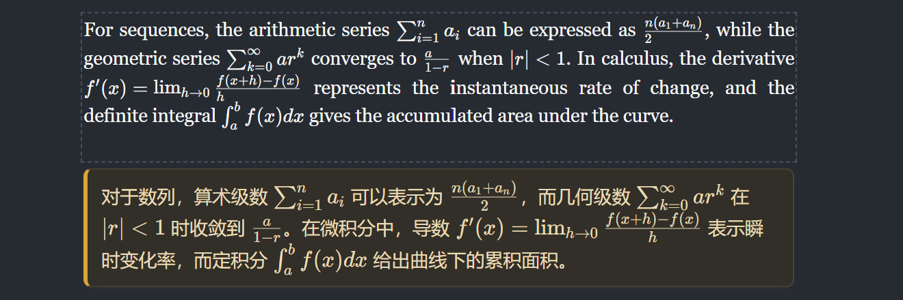
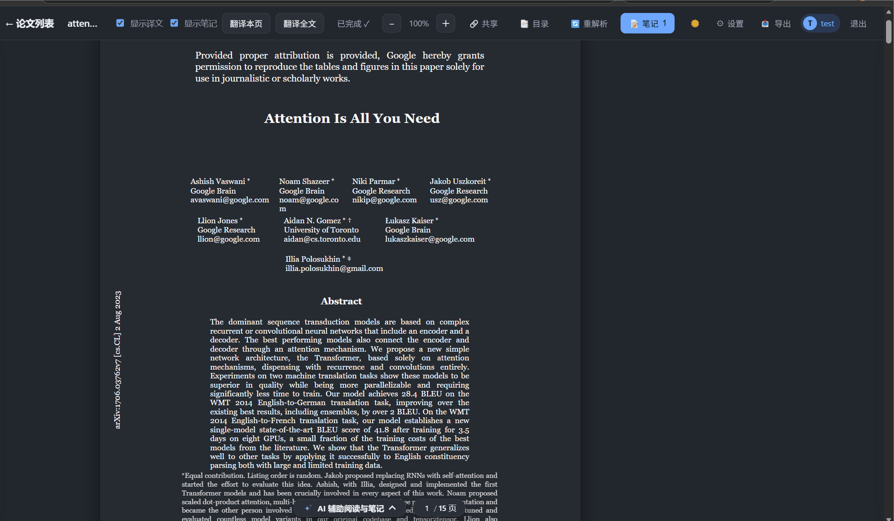
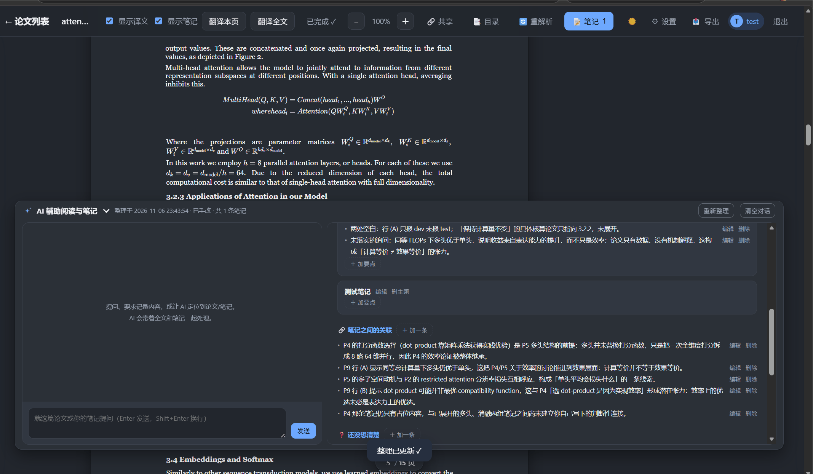

# Tardigrade Paper Reader - Pdf 转 HTML 阅读应用

> AI 辅助工具为 Deepseek-v4-flash/Deepseek-v4.1-flash/GPT-6-Luna + VScode copilot

## 更新

1. [26/10/8] surya 解析与pymupdf解析分离，解析pdf和渲染路径独立，解决了surya解析时公式和图片重影问题，增加表格渲染
   
   

    
   

2. [26/10/8] 增加了多种翻译目标语言
   
   

   
   

3. [26/10/8] ai辅助阅读增加 markdown 样式渲染。
4. [26/10/11] 增加 Unlimited-OCR 解析和渲染路径，调整表格渲染样式为三线表。
   
   

5. [26/10/16] 为本地pymupdf解析/surya解析/unlimited-ocr解析增加了参考文献链接显示功能，避免查找繁琐。unlimited-ocr解析不稳定（unlimited-ocr在26/10/14更新后好像没有之前好用了）。
   
   

   

6. [26/10/30] a. 增加本地解析方案，使用pymupdf+OXR的版面分析模型+量化后的texify+SLANet，对latex代码编译的pdf有效；b. 优化参考文献显示功能，信息卡片持久显示和作者-年份引用显示效果；c. 翻译功能，翻译卡片可显示公式。
   
   

7. [26/11/7] a. Unlimited-OCR增加官网api调用；b. 增加ai辅助阅读时的agent功能，可以通过聊天找到论文相关内容/笔记位置 和 帮助写入笔记内容；c. 更换logo（水熊虫三角立体艺术拼接风格）

8. [26/11/9] a. agent功能拆分 b. 增加笔记导出功能（agent分析总结；校验参考文献需要到设置里配置检索api key） c. ai辅助阅读形式更改为底部胶囊卡片（打开收起方式详见功能5）。 

9. [26/11/12] 前端页面显示和元素排布调整，阅读界面缩放改为5%间隔的滑轮缩放/拖动缩放。

 
## Pdf 解析模块

把论文 PDF 解析成**可还原原版式的数据**（文字块 + 插图，保留原坐标、字号、字体）。提供三种解析方式，输出结构一致，前端无需改动。

### 1. 本地解析方案

不依赖显卡和外部服务，装好即用，也是其他方式不可用时的**兜底**，解析latex代码编译生成的pdf效果最好。

- 文字按 PDF 原始行框、字号、字体、颜色还原；
- 自动提取插图（内嵌图片与矢量图表），过滤整页背景、过小贴图；
- 数学公式（独立公式和行内公式）提取靠字体识别+texify转换。
- 使用前需要下载，详情查看该模块中的 [local_parse_pipeline/README.md](./paper-trans-to-html/backend/pdf_parser/local_parse_pipeline/README.md)

### 2. Surya

接入 **Surya 2 推理服务**，由服务端做版面分析与整页识别（部署方式见 `surya_doc_parse_service`）。

- 按版面分块还原阅读顺序，插图自动裁剪保存；
- 表格保留结构，公式识别为 LaTeX 并渲染成数学公式；
- 电子版论文仍以原始精确版式为准，扫描件用识别结果还原。

### 3. Unlimited-OCR

接入 **Unlimited-OCR 推理服务**，Unlimited-OCR模型做版面分析、文本和图表的检测和识别（部署方式见 `unlimited_ocr_service`）。增加 Unlimited-OCR 2 的官网api调用，需要再百度智能云平台创建应用。程序检测本地部署不存在时自动切换至api调用模式。

- 逐页识别，文本、图片和表格
- 需要配置 config.json 中的unlimited_ocr_online_api_key和unlimited_ocr_online_secret_key

## MongoDB 数据存储

论文数据全部存放在 MongoDB（部署方式见 `mongo_configuration/`，Docker Compose 一键启动）。默认只监听本机，只有本机上的应用能连，更适合个人使用。

存放内容：

- **论文** —— 元数据、页数、阅读进度与状态，以及论文归属的账号；
- **版式数据与插图** —— 解析结果与论文插图，重启、重建容器、换机器都不会丢；
- **高亮 / 笔记 / 译文** —— 标注与译文缓存，相同句子不重复翻译；
- **账号与会话** —— 登录账号（口令加盐哈希存储）、登录会话（过期自动清理）、每个账号各自的偏好与 LLM 配置。

数据按账号隔离：每个账号只能看到并操作自己上传的论文。

数据库没启动也能正常用：应用会自动回退到本地文件存储并在页面上提示，点「重试连接」即可切回数据库，不用重启服务。

## LLM 设置
LLM 设置预设了OpenAI、Anthoripic、deepseek和本地模式可供选择，实现上来说没有固定base url，可以任意选择，能够保存的设置只有3套。

## 使用功能

### 1. 多用户和设置

### 3. 论文载入和删除、标注、笔记和翻译

### 4. 笔记整理和AI辅助、笔记共享

### 5. 笔记和内容定位、笔记添加

## TODO

- [x] ~~公式解析优化，重影缺失等问题~~
- [x] ~~图片显示，子图caption重影缺失等问题~~
- [x] ~~pymupdf 本地解析优化~~
- [x] ~~unlimited ocr 解析和渲染路径实现~~
- [x] ~~引用链接显示功能优化~~
- [x] ~~unlimited-ocr解析后端优化~~
- [x] ~~笔记导出功能~~
- [ ] Agent功能优化

<!-- https://github.com/MarcYugo/tardigrade-paper-reader -->