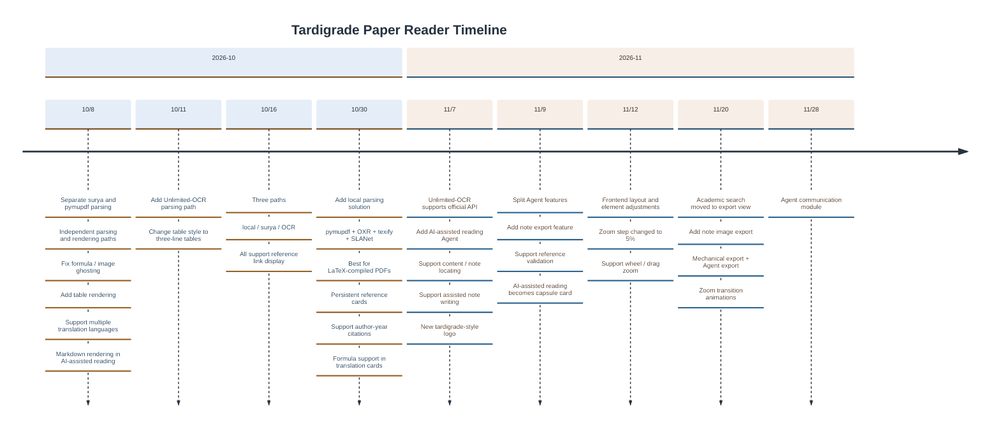
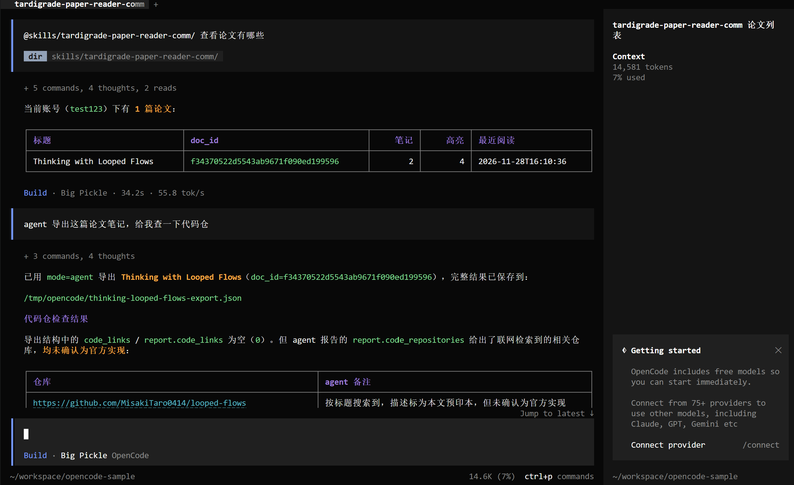
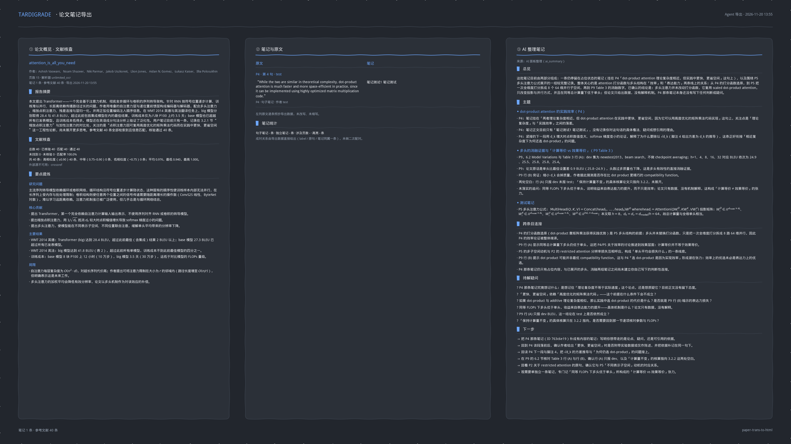
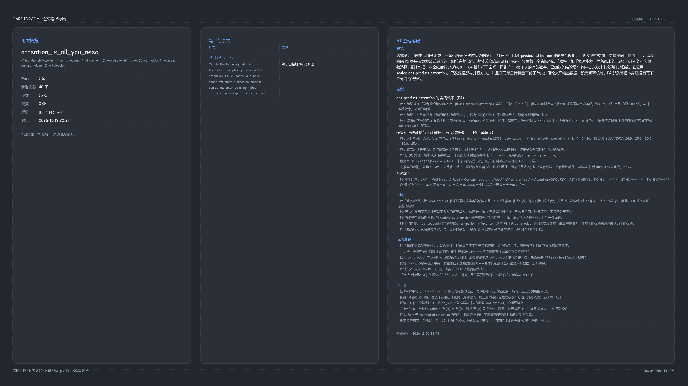

# Tardigrade Paper Reader - PDF to HTML Reading App

[简体中文](./README.md) | **English**

> AI-assisted tools: Deepseek-v4-flash / Deepseek-v4.1-flash / GPT-6-Luna + VScode copilot

> For personal use — take it if you need it

## Updates

📋 View detailed update notes (click to expand)

1. [26/10/8] Separated surya parsing from pymupdf parsing. The PDF parsing and rendering paths are now independent, which fixes formula and image ghosting in surya parsing, and adds table rendering.
   
   

    
   

2. [26/10/8] Added multiple target languages for translation.
   
   

   
   

3. [26/10/8] Added Markdown-style rendering to AI-assisted reading.
4. [26/10/11] Added the Unlimited-OCR parsing and rendering path, and changed the table rendering style to three-line tables.
   
   

5. [26/10/16] Added reference link display for local pymupdf parsing / surya parsing / unlimited-ocr parsing, so references no longer need to be looked up manually. unlimited-ocr parsing is unstable (it seems less reliable after the 26/10/14 update).
   
   

   

6. [26/10/30] a. Added a local parsing solution using pymupdf + OXR layout analysis model + quantized texify + SLANet, which works well for PDFs compiled from LaTeX; b. Improved reference display: persistent info cards and author-year citation display; c. Translation cards can now display formulas.
   
   

7. [26/11/7] a. Unlimited-OCR now supports calls to the official API; b. Added an Agent for AI-assisted reading that can locate related paper content / notes through chat and help write note content; c. New logo (tardigrade triangular 3D art collage style).

8. [26/11/9] a. Split Agent features; b. Added note export (Agent analysis and summary; validating references requires configuring a search API key in settings); c. AI-assisted reading is now shown as a bottom capsule card (see feature 5 for how to open and collapse it). 

9. [26/11/12] Adjusted frontend page display and element layout. Reading view zoom now uses 5% steps with wheel zoom / drag zoom.

10. [26/11/20] a. Moved the academic search view into the export view, and merged the agents into skills of a single agent; b. Added note image export (mechanical export and Agent export), see feature 6 for examples; c. Added zoom transition animations, covering actions such as paper pages / settings and note indentation;

11. [26/11/28] Added the Agent communication module.

## Architecture

See [paper-trans-to-html/README.md](./paper-trans-to-html/README.md) for the architecture design.

```mermaid
%%{init: {'theme':'base','themeVariables':{'fontFamily':'Inter, -apple-system, Segoe UI, PingFang SC, Microsoft YaHei, sans-serif','fontSize':'13px','lineColor':'#8fa1b3','textColor':'#243447','primaryColor':'#ffffff','primaryTextColor':'#243447','primaryBorderColor':'#cfd8e3','edgeLabelBackground':'#ffffff','clusterBkg':'#ffffff','clusterBorder':'#d8e0ea'},'flowchart':{'curve':'basis','nodeSpacing':30,'rankSpacing':44,'padding':12}}}%%
flowchart TB
    subgraph FE["① Presentation layer · Browser — vanilla HTML / CSS / JS · no framework · no build"]
        FE1["Login · Sign-up<br/>login.html / login.js"]
        FE2["Paper list · Sharing<br/>index.html / home.js"]
        FE3["Reader assembly<br/>reader.html / reader2.js"]
        FE4["Layout rendering · three backends<br/>core / items"]
        FE5["Sentence zoom · Selection translation<br/>select / bar / translate"]
        FE6["Notes · AI · Citations · TOC<br/>r2-notes / r2-ai / r2-refs / katex"]
    end

    subgraph AG["⑤ Agent runtime · backend/agents"]
        AG1["Runtime agent.py<br/>tool loop · history hygiene"]
        AG2["LLM access llm.py<br/>streaming · tool_calls · three profiles"]
        AG3["Skill · Assisted reading<br/>write digest cards · locate page / notes"]
        AG4["Skill · Note export<br/>verify references · generate report"]
        AG5["Skill · Note images<br/>generate drawing code"]
        AG6["Skill · Comm bridge<br/>transfer key · consume / reply"]
        AG1 ~~~ AG2 ~~~ AG3 ~~~ AG4 ~~~ AG5 ~~~ AG6
    end

    subgraph CORE[" "]
        subgraph CHAIN["⑥ Parsing chain · three independent backends"]
            direction LR
            P1["Local solution<br/>pymupdf + OXR + texify + SLANet"]
            P2["Surya 2<br/>inference service :8060"]
            P3["Unlimited-OCR<br/>:9010 / official API"]
        end
        subgraph CAP["③ Capability layer · domain modules"]
            C1["Parsing facade pdf_parser<br/>unified contract parse_pdf"]
            C2["Document assembly converter<br/>documents + figures"]
            C3["Citation mapping pdf_refs<br/>three strategies · fully local"]
            C4["Translation translate<br/>batch · cache · fallback"]
            C5["AI reading ai_read<br/>summary · streaming chat"]
            C6["Note export notes_out<br/>data · images · reference check"]
            C1 ~~~ C2 ~~~ C3 ~~~ C4 ~~~ C5 ~~~ C6
        end
        subgraph APP["② Application layer · FastAPI monolith app.py"]
            A1["HTTP API + static hosting<br/>AuthGate · 302 / 401"]
            A2["Accounts / sessions / preferences<br/>auth.py · settings.py · PBKDF2"]
            A3["API groups<br/>docs · anno · translate · ai · share"]
            A1 ~~~ A2 ~~~ A3
        end
        subgraph STOR["④ Storage layer · storage / mongo_store"]
            S1["Storage assembly<br/>APP_STORAGE auto / mongo / json"]
            S2["Mongo · GridFS<br/>collection IO · figure storage"]
            S3["Local JSON fallback<br/>data/ · hot switch"]
            S1 ~~~ S2
            S1 ~~~ S3
        end
    end

    subgraph INFRA["⑦ External services · sandbox / comm module / database"]
        I4["LLM services<br/>DeepSeek · OpenAI · Ollama"]
        I1["draw-sandbox :8090<br/>drawing sandbox"]
        I2["agent_comm_service<br/>Redis Streams · comm gateway"]
        I5["Academic search<br/>OpenAlex · Semantic Scholar"]
        I3[("MongoDB · GridFS<br/>nine collections + figure blobs")]
    end

    %% ── Presentation layer → Application layer ──
    FE1 ==>|"HTTP"| A1
    FE2 ==>|"fetch"| A1
    FE3 ==>|"fetch / SSE"| A1

    %% ── Application layer internals ──
    A1 ==>|"auth / preferences"| A2
    A2 ==>|"route dispatch"| A3

    %% ── Application layer → Capability layer ──
    A1 ==>|"parse_pdf"| C1
    A3 -->|"citation mapping"| C3
    A3 -->|"batch translation"| C4
    A3 -->|"summary / chat"| C5
    A3 -->|"note export"| C6

    %% ── Application layer → Storage layer / Agent ──
    A3 ==>|"session / preference IO"| S1
    A1 ==>|"SSE / report"| AG1

    %% ── Capability layer internals → Storage layer ──
    C1 ==>|"layout JSON"| C2
    C2 -->|"documents / figures"| S2
    S1 ==>|"read / write"| S2
    S1 -.->|"auto fallback"| S3

    %% ── Parsing chain → Capability layer (A3 ~~~ P2 is only a layout constraint: it pins the
    %%    whole parsing chain above the capability layer; the order in which the edges are declared
    %%    sets the left-to-right order within the chain: Local solution / Surya 2 / Unlimited-OCR) ──
    A3 ~~~ P2
    P3 ==> C1
    P2 ==> C1
    P1 ==>|"switch per account"| C1

    %% ── Agent internals ──
    AG1 ==>|"streaming / tool_calls"| AG2
    AG1 ==> AG3
    AG1 ==> AG4
    AG1 ==> AG5
    AG1 ==> AG6

    %% ── Agent skills → Capability layer (reuse) ──
    AG3 -.->|"reuse ai_read"| C5
    AG4 -.->|"reuse notes_out"| C6

    %% ── External services ──
    AG2 -.->|"chat"| I4
    AG5 -.->|"drawing code"| I1
    AG6 -.->|"consume / reply"| I2
    C6 -.->|"reference check"| I5
    S2 ==>|"persist"| I3

    %% ── Layout skeleton (invisible) ──
    AG6 ~~~ I4
    C6 ~~~ I1
    C6 ~~~ I2
    C6 ~~~ I3

    classDef feN fill:#f7f9fc,stroke:#c3cfdd,stroke-width:1.2px,color:#243447
    classDef agN fill:#faf8f5,stroke:#d6c9b8,stroke-width:1.2px,color:#3d3428
    classDef capN fill:#f4f7fa,stroke:#a8bccf,stroke-width:1.2px,color:#1f3242
    classDef appN fill:#f5f7f9,stroke:#9db0c0,stroke-width:1.2px,color:#22303c
    classDef stoN fill:#f2f5f4,stroke:#9fb5ab,stroke-width:1.2px,color:#22382f
    classDef chN fill:#f3f7f4,stroke:#a3bfa8,stroke-width:1.2px,color:#26382c
    classDef infN fill:#f4f3f1,stroke:#b8b0a4,stroke-width:1.2px,color:#33302a
    classDef dbN fill:#2e3a45,stroke:#2e3a45,stroke-width:1.2px,color:#eef2f6

    class FE1,FE2,FE3,FE4,FE5,FE6 feN;
    class AG1,AG2,AG3,AG4,AG5,AG6 agN;
    class C1,C2,C3,C4,C5,C6 capN;
    class A1,A2,A3 appN;
    class S1,S2,S3 stoN;
    class P1,P2,P3 chN;
    class I4,I1,I2,I5 infN;
    class I3 dbN;

    style FE fill:#fbfcfe,stroke:#dfe6ee,stroke-width:1.4px,color:#33475b
    style AG fill:#fbfaf8,stroke:#e6ddcf,stroke-width:1.4px,color:#4a4034
    style CORE fill:#ffffff,stroke:#d8e0ea,stroke-width:1.4px,color:#33475b
    style CAP fill:#f8fafc,stroke:#c6d3e0,stroke-width:1.2px,color:#33475b
    style APP fill:#f8f9fb,stroke:#c9d2dd,stroke-width:1.2px,color:#33475b
    style STOR fill:#f7faf8,stroke:#c4d6cd,stroke-width:1.2px,color:#33475b
    style CHAIN fill:#f8fbf8,stroke:#cfe0d2,stroke-width:1.4px,color:#33475b
    style INFRA fill:#faf9f7,stroke:#ddd6cb,stroke-width:1.4px,color:#4a4034
```

## PDF Parsing Module

Parses paper PDFs into **data that can reproduce the original layout** (text blocks + figures, preserving original coordinates, font sizes, and fonts). Three parsing methods are provided; their output structure is identical, so the frontend needs no changes.

<table>
	<thead>
		<tr>
			<th align="center" width="18%">Parsing method</th>
			<th align="center" width="24%">Dependencies and deployment</th>
			<th align="center">Core capabilities</th>
			<th align="center" width="26%">Use cases / notes</th>
		</tr>
	</thead>
	<tbody>
		<tr>
			<td align="center"><strong>🖥️ Local parsing</strong> pymupdf + OXR + texify + SLANet</td>
			<td>No GPU or external services required, works right after installation Models must be downloaded in advance, see <a href="./paper-trans-to-html/backend/pdf_parser/local_parse_pipeline/README.md">local_parse_pipeline/README.md</a></td>
			<td>
				<ul>
					<li>Text restored according to the original PDF line boxes, font sizes, fonts, and colors</li>
					<li>Figures extracted automatically (embedded images and vector charts), filtering out full-page backgrounds and overly small images</li>
					<li>Display and inline formulas handled via font recognition + texify conversion</li>
				</ul>
			</td>
			<td><strong>Fallback</strong> when the other methods are unavailable; gives the best results for PDFs compiled from LaTeX</td>
		</tr>
		<tr>
			<td align="center"><strong>📄 Surya</strong> Surya 2 inference service</td>
			<td>Connects to server-side layout analysis and full-page recognition See <code>services/surya_doc_parse_service</code> for deployment</td>
			<td>
				<ul>
					<li>Restores reading order by layout blocks, and figures are cropped and saved automatically</li>
					<li>Tables keep their structure, and formulas are recognized as LaTeX and rendered as math formulas</li>
					<li>Digital papers still follow the original exact layout, while scanned documents are restored from recognition results</li>
				</ul>
			</td>
			<td>Works for both digital and scanned papers, with strong layout structure reconstruction</td>
		</tr>
		<tr>
			<td align="center"><strong>🔍 Unlimited-OCR</strong> Unlimited-OCR inference service / official API</td>
			<td>See <code>services/unlimited_ocr_service</code> for local service deployment; automatically switches to the official API when no local deployment is found The API requires creating an app on the Baidu AI Cloud platform and configuring <code>unlimited_ocr_online_api_key</code> and <code>unlimited_ocr_online_secret_key</code> in <code>config.json</code></td>
			<td>
				<ul>
					<li>The Unlimited-OCR model performs layout analysis and detection / recognition of text, figures, and tables</li>
					<li>Recognized page by page, covering text, images, and tables</li>
				</ul>
			</td>
			<td>OCR recognition for scanned papers; supports calling the Unlimited-OCR 2 official API</td>
		</tr>
	</tbody>
</table>

## MongoDB Data Storage

All paper data is stored in MongoDB (see `services/mongo_configuration/` for deployment). By default it only listens on localhost, so only apps on this machine can connect, which is more suitable for personal use.

Stored content:

- **Papers** — metadata, page count, reading progress and status, and the account each paper belongs to;
- **Layout data and figures** — parsing results and paper figures; they are not lost after restarting, rebuilding containers, or switching machines;
- **Highlights / Notes / Translations / Reference checks** — annotations and translation cache, so the same sentence is not translated twice;
- **Accounts and sessions** — login accounts (passwords stored as salted hashes), login sessions (expired ones are cleaned up automatically), and each account's own preferences and LLM settings.

Data is isolated by account: each account can only see and operate its own uploaded papers.

The app still works when the database is not started: it automatically falls back to local file storage and shows a notice on the page. Click "Retry connection" to switch back to the database without restarting the service.

## Agent Communication Module

Redis stores the messages and the data passed between parties, and Redis Streams carry the messages. External agents hold a transfer key and send messages through the communication app to the tardigrade reader agent, which then retrieves the papers and notes of the corresponding account.
The communication module requires a MongoDB deployment (`services/mongo_configuration`), since the transfer keys are stored there.
See `services/agent_comm_service` for deployment; the module design and its stress tests are documented in [agent-comm-service/README.md](./services/agent_comm_service/README.md).

To communicate with the built-in tardigrade agent from other agent products, a skill must be configured; see `opencode-sample` for an example.

<table>
    <tr>
        <td align="center"></td>
        <td align="center"></td>
    </tr>
</table>

## LLM Settings
The LLM settings preset OpenAI, Anthropic, deepseek, and a local mode to choose from. In practice there is no fixed base URL and any can be chosen. Only up to 3 settings can be saved.

## Features

### 1. Multi-user and settings

<table>
	<tr>
		<td align="center"></td>
		<td align="center"></td>
	</tr>
</table>

### 3. Paper loading and deletion, annotation, notes, and translation

<table>
	<tr>
		<td align="center"></td>
		<td align="center"></td>
	</tr>
</table>

### 4. Note organization and AI assistance, note sharing

<table>
	<tr>
		<td align="center"></td>
		<td align="center"></td>
	</tr>
</table>

### 5. Note and content locating, adding notes

<table>
	<tr>
		<td align="center"></td>
		<td align="center"></td>
	</tr>
</table>

### 6. Note export (image export example)

Exporting note images with the Agent requires starting the sandbox container `services/draw_sandbox_service`.

<table>
	<tr>
		<td align="center"></td>
		<td align="center"></td>
		<td align="center"></td>
	</tr>
</table>

## TODO

- [x] ~~Formula parsing optimization: ghosting and missing issues~~
- [x] ~~Image display: ghosting and missing subfigure captions~~
- [x] ~~pymupdf local parsing optimization~~
- [x] ~~Implement unlimited ocr parsing and rendering path~~
- [x] ~~Citation link display optimization~~
- [x] ~~unlimited-ocr parsing backend optimization~~
- [x] ~~Note export feature~~
- [x] ~~Agent communication module design~~
- [ ] Agent feature optimization
- [ ] Internal code optimization of the app
- [ ] Note import feature

<!-- https://github.com/MarcYugo/tardigrade-paper-reader -->
