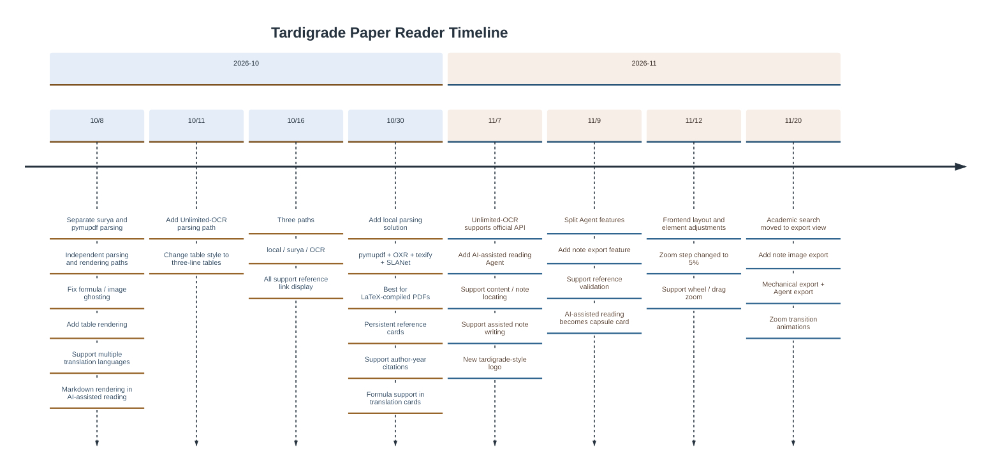
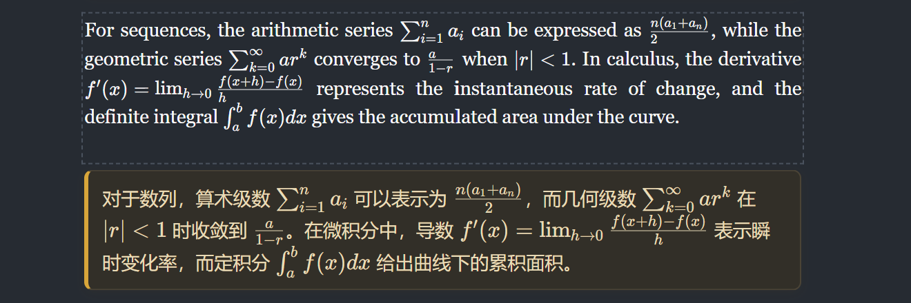
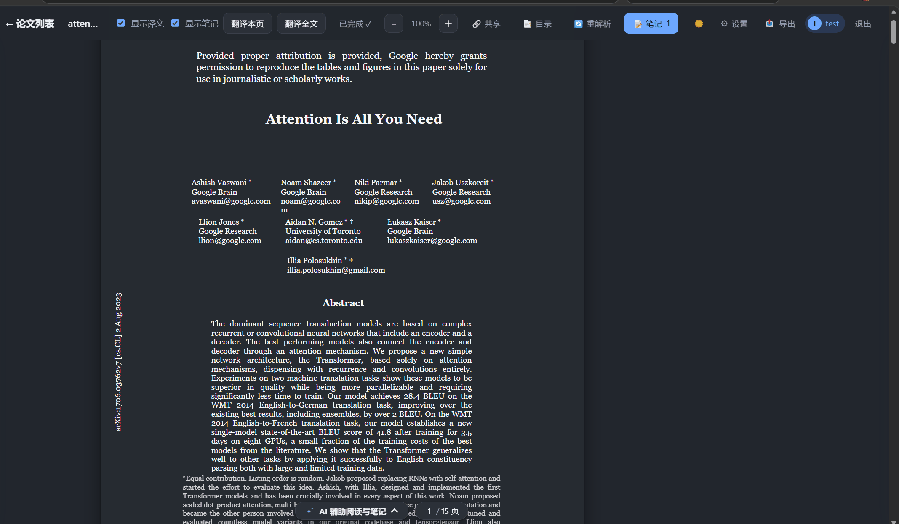
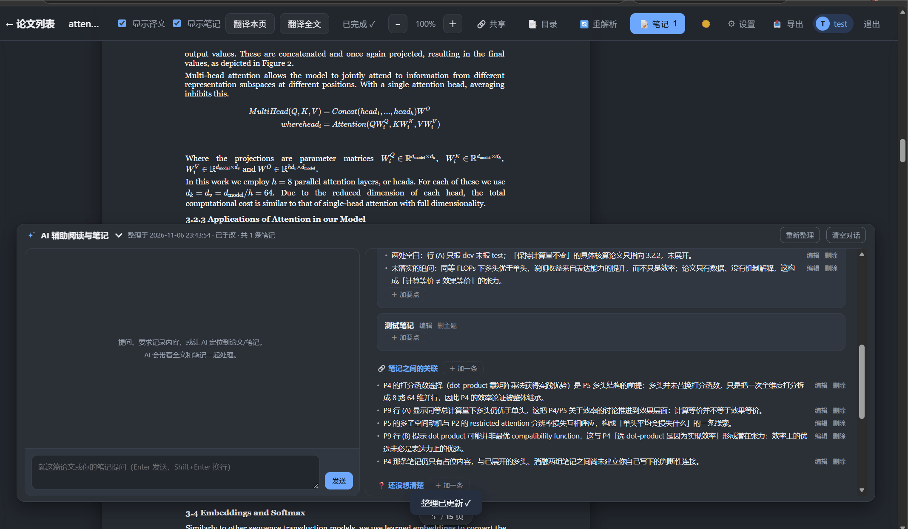
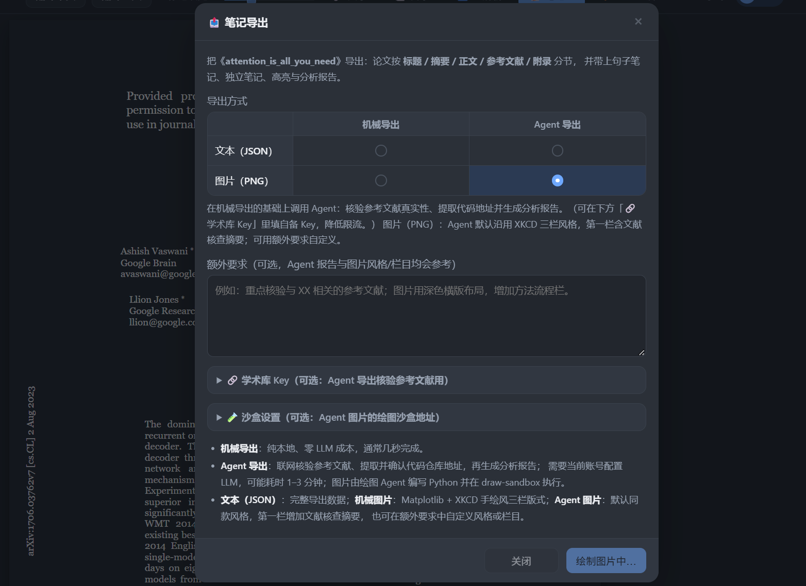

# Tardigrade Paper Reader - PDF to HTML Reading App

[简体中文](./README.md) | **English**

> AI-assisted tools: Deepseek-v4-flash / Deepseek-v4.1-flash / GPT-6-Luna + VScode copilot

## Updates

1. [26/10/8] Separated surya parsing from pymupdf parsing. The PDF parsing and rendering paths are now independent, which fixes formula and image ghosting in surya parsing, and adds table rendering.

   

    
   

2. [26/10/8] Added multiple target languages for translation.

   

   
   

3. [26/10/8] Added Markdown-style rendering to AI-assisted reading.
4. [26/10/11] Added the Unlimited-OCR parsing and rendering path, and changed the table rendering style to three-line tables.

   

5. [26/10/16] Added reference link display for local pymupdf parsing / surya parsing / unlimited-ocr parsing, so references no longer need to be looked up manually. unlimited-ocr parsing is unstable (it seems less reliable after the 26/10/14 update).

   

   

6. [26/10/30] a. Added a local parsing solution using pymupdf + OXR layout analysis model + quantized texify + SLANet, which works well for PDFs compiled from LaTeX; b. Improved reference display: persistent info cards and author-year citation display; c. Translation cards can now display formulas.

   

7. [26/11/7] a. Unlimited-OCR now supports calls to the official API; b. Added an Agent for AI-assisted reading that can locate related paper content / notes through chat and help write note content; c. New logo (tardigrade triangular 3D art collage style).

8. [26/11/9] a. Split Agent features; b. Added note export (Agent analysis and summary; validating references requires configuring a search API key in settings); c. AI-assisted reading is now shown as a bottom capsule card (see feature 5 for how to open and collapse it).

9. [26/11/12] Adjusted frontend page display and element layout. Reading view zoom now uses 5% steps with wheel zoom / drag zoom.

10. [26/11/20] a. Moved the academic search view into the export view, and merged the agents into skills of a single agent; b. Added note image export (mechanical export and Agent export), see feature 6 for examples; c. Added zoom transition animations, covering actions such as paper pages / settings and note indentation;

## PDF Parsing Module

Parses paper PDFs into **data that can reproduce the original layout** (text blocks + figures, preserving original coordinates, font sizes, and fonts). Three parsing methods are provided; their output structure is identical, so the frontend needs no changes.

### 1. Local Parsing Solution

Does not depend on a GPU or external services and works right after installation. It is also the **fallback** when other methods are unavailable, and gives the best results for PDFs compiled from LaTeX.

- Text is restored according to the original PDF line boxes, font sizes, fonts, and colors;
- Figures are extracted automatically (embedded images and vector charts), filtering out full-page backgrounds and overly small images;
- Math formulas (display and inline) are extracted via font recognition + texify conversion.
- Requires downloading before use; see [local_parse_pipeline/README.md](./paper-trans-to-html/backend/pdf_parser/local_parse_pipeline/README.md) in that module for details.

### 2. Surya

Connects to the **Surya 2 inference service**, which performs layout analysis and full-page recognition on the server side (see `services/surya_doc_parse_service` for deployment).

- Restores reading order by layout blocks, and figures are cropped and saved automatically;
- Tables keep their structure, and formulas are recognized as LaTeX and rendered as math formulas;
- Digital papers still follow the original exact layout, while scanned documents are restored from recognition results.

### 3. Unlimited-OCR

Connects to the **Unlimited-OCR inference service**. The Unlimited-OCR model performs layout analysis, text detection and recognition, and figure/table detection and recognition (see `services/unlimited_ocr_service` for deployment). It also supports calling the official API of Unlimited-OCR 2, which requires creating an app on the Baidu AI Cloud platform. When no local deployment is detected, the program automatically switches to API mode.

- Recognition page by page, covering text, images, and tables
- Requires configuring `unlimited_ocr_online_api_key` and `unlimited_ocr_online_secret_key` in `config.json`

## MongoDB Data Storage

All paper data is stored in MongoDB (see `services/mongo_configuration/` for deployment, one-click startup with Docker Compose). By default it only listens on localhost, so only apps on this machine can connect, which is more suitable for personal use.

Stored content:

- **Papers** — metadata, page count, reading progress and status, and the account each paper belongs to;
- **Layout data and figures** — parsing results and paper figures; they are not lost after restarting, rebuilding containers, or switching machines;
- **Highlights / Notes / Translations** — annotations and translation cache, so the same sentence is not translated twice;
- **Accounts and sessions** — login accounts (passwords stored as salted hashes), login sessions (expired ones are cleaned up automatically), and each account's own preferences and LLM settings.

Data is isolated by account: each account can only see and operate its own uploaded papers.

The app still works when the database is not started: it automatically falls back to local file storage and shows a notice on the page. Click "Retry connection" to switch back to the database without restarting the service.

## LLM Settings
The LLM settings preset OpenAI, Anthoripic, deepseek, and a local mode to choose from. In practice there is no fixed base URL and any can be chosen. Only up to 3 settings can be saved.

## Features

### 1. Multi-user and settings

### 3. Paper loading and deletion, annotation, notes, and translation

### 4. Note organization and AI assistance, note sharing

### 5. Note and content locating, adding notes

### 6. Note export (image export example)

Exporting note images with the Agent requires starting the sandbox container `services/draw_sandbox_service`.

## TODO

- [x] ~~Formula parsing optimization: ghosting and missing issues~~
- [x] ~~Image display: ghosting and missing subfigure captions~~
- [x] ~~pymupdf local parsing optimization~~
- [x] ~~Implement unlimited ocr parsing and rendering path~~
- [x] ~~Citation link display optimization~~
- [x] ~~unlimited-ocr parsing backend optimization~~
- [x] ~~Note export feature~~
- [ ] Agent feature optimization
- [ ] Agent communication module design

<!-- https://github.com/MarcYugo/tardigrade-paper-reader -->
