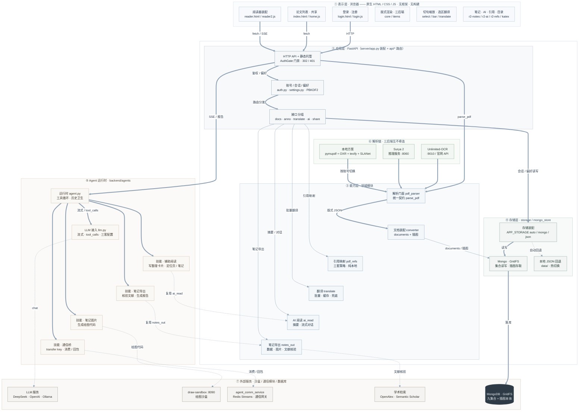

# Targigrade 论文 PDF 转 HTML 阅读器

> 本文件是 [note.md](./note.md) 的精炼版，分三块：**简介 / 功能设计 / 架构设计**。完整实现细节、踩坑记录与排障说明仍以 note.md 为准。

---

## 一、简介

**论文 PDF 转 HTML 阅读器**是一个面向单机与小团队自用的论文阅读系统：上传论文 PDF，后端把它解析成**保留原文版式**的结构化数据，前端在浏览器里逐页还原成可读网页，并在同一平面上叠加整段翻译、句子级高亮与笔记、引用跳转、目录、阅读记录管理、多账号共享与 AI 阅读 Agent。

- **技术栈**：后端 Python + FastAPI（单体）；存储 MongoDB（含 GridFS，连不上时自动回退本地 JSON）；前端原生 HTML/CSS/JS（无框架、无构建步骤）；公式渲染内置离线 KaTeX；LLM 统一走 OpenAI 兼容接口（DeepSeek / OpenAI / vLLM / Ollama / 中转 / Google 免费兜底）；可选外部 OCR 推理服务（Surya 2、Unlimited-OCR，并有百度智能云在线解析兜底）。
- **三条版式后端**可按账号在设置面板切换：本地解析方案（PyMuPDF + texify 公式 + OXR 版面 + SLANet 表格）、Surya 2 整页 OCR、Unlimited-OCR 整页 OCR。
- **多账号协作**：论文数据按账号隔离，LLM 配置、目标语言、高亮色、主题等偏好跟账号走；支持论文级只读/可写共享、每人独立阅读进度、笔记作者标识、自助注册与注销。
- **AI 阅读 Agent**：带全文与公式上下文的流式对话，两个受限工具（写入笔记整理卡片、经确认后定位论文页/笔记），读完后自动产出总览 / 主题 / 关联 / 待想清楚 / 下一步的结构化整理。
- **体验取向**：所有交互都"不破坏版式"—— 译文与笔记靠顶开/让位实现，收起后原样还原；逐页加载 + 精确位置回位；重排不跳页；暗夜模式下 PDF 正文色按"保留色相、反转明度"换算、高亮转荧光。

### 快速开始

```bash
# 0. 启动 MongoDB（同级目录 ../services/mongo_configuration；不启也能跑，会自动回退本地 JSON）
cd ../services/mongo_configuration && cp .env.example .env && docker compose up -d && cd ../../paper-trans-to-html

# 1. 依赖（建议虚拟环境）
python -m venv .venv
.venv/Scripts/activate            # Linux/macOS: source .venv/bin/activate
pip install -r requirements.txt

# 2.（可选）先配翻译服务：cp config.example.json config.json，或直接设 DEEPSEEK_API_KEY
#    也可以完全不配，首次进网页时按引导填

# 3. 启动
python run.py                     # 打开 http://127.0.0.1:8000
```

首次访问按引导「创建管理员账号 → 配置 LLM 服务（可当场测试连接）」即可使用；配置常驻在右上角 `⚙ 设置`（LLM 服务 / 翻译目标语言 / 存储与 OCR / 账号）。

### 适用与边界

登录体系面向单机自用：首个账号即管理员，无角色体系与找回密码，会话 Cookie 未开 `Secure` —— **不要把服务直接暴露公网**；需要外网访问请自行加 HTTPS 反向代理与访问控制，并设 `ALLOW_SIGNUP=0`。MongoDB 为单机单副本，数据可靠性靠宿主机的数据卷（`mongodump`/`mongorestore`）。句子切分基于英文标点启发式（对 `Fig.`/`e.g.`/`et al.` 等有保护），极少数学术句可能切不准。去重影会删除已烘进插图里的文字行，这些行不再可选/可译。

---

## 二、功能设计

### 2.1 功能清单

| # | 功能 | 要点 |
| --- | --- | --- |
| 1 | **登录验证 + 首次配置** | 服务端 `AuthGate` 中间件兜底：未登录时页面请求 302 到登录页、接口请求 401（不是只靠前端藏按钮）。首个账号即管理员，随后引导配置 LLM 服务（地址 / Key / 模型 + 测试连接），可"稍后配置"跳过。口令 PBKDF2-SHA256 + 随机盐 + 20 万轮，校验用常量时间比较；会话为 HttpOnly + SameSite=Lax Cookie（默认 14 天，Mongo 侧 TTL 自动清理）；登录失败限流（同"用户名 + IP"连续 8 次锁 5 分钟）。 |
| 2 | **多账号与数据隔离** | 登录页有「登录 / 注册新账号」两页签，**不登录也能注册**（`ALLOW_SIGNUP` 默认开，`MAX_ACCOUNTS` 默认 50）。论文按 `owner` 隔离，新账号进去是空列表，越权访问一律 404（不泄露存在性）。头像菜单可查看账号列表（含各自论文数）、新增账号、删除其他账号（可选连带论文）。**自助注销**需重输当前密码 + 用户名并二次确认，账号与其全部数据永久删除；若注销的是最后一个账号，服务回到"首次使用"状态。 |
| 3 | **LLM 配置按账号隔离、可多套** | 每账号一份 LLM 配置，与论文数据同样隔离；同一账号可保留最多 **3 套**不同服务的配置（官方 / 中转 / 本地 Ollama…）并一键切换；删除正在用的那套会自动切到剩下的，3 套全删则回落到安装级默认。「测试连接」按所选那套已保存的 Key 试一次（页面只显示打码串）。Key 只存服务端，接口一律返回打码串。同一「⚙ 设置」里的 **学术检索** 页签则存 OpenAlex / Semantic Scholar 的 Key、Semantic Scholar 服务地址（默认走兼容代理 `https://s2api.ominiai.cn/s2`，用 `Authorization: Bearer <令牌>`；改成 `https://api.semanticscholar.org` 即回官方直连、改用 `x-api-key`）与联系邮箱，同样按账号存、没配就回落环境变量 / `.env`，供笔记导出时逐条核验参考文献，也带「测试连接」（逐个库试一次并给出原因）。 |
| 4 | **版式还原** | 文字块与图片按原 PDF 坐标 / 字号 / 字体 / 颜色重建；每条文字行自动按 PDF 线框适配宽度，双栏紧排不会因字体宽度差异侵入栏间空隙造成文字重合。旋转文字（竖排页边章、倒排）按 `line["dir"]` 下发 `rot`/`ox·oy`/`rw·rh`，前端 `rotate()` 摆回。 |
| 5 | **三种可选解析后端** | `pymupdf`/`auto` = 本地解析方案；`surya` = Surya 2 整页 OCR（文字 / `<math>`→LaTeX 公式 / 插图裁图全部来自 Surya，前端独立渲染）；`unlimited_ocr` = Unlimited-OCR 整页 OCR（文字 / 公式 / 表格 / 插图全部来自它自己，前端独立渲染）。后端按账号在「⚙ 设置 → 存储 / OCR」切换，面板显示实际生效值与各服务就绪状态。 |
| 6 | **翻译（非实时，12 种目标语言）** | 目标语言跟账号走（`users.prefs.target_lang`），译文缓存按「语言 + 文本」哈希分开存 —— 换语言不命中旧译文、切回来仍在；换语言后阅读页自动清旧译文重新拉取。点句 → 该段**之后**显示整段译文并自动顶开后续内容；拖选多句 → `翻译所选句子` 只译所选句（跨段落按段切片分别翻译再合并）。两种译文**互斥**，但多张"所选句译文"卡可并存、各对应不同选区。支持翻译本页 / 全文（批量、可取消、结果缓存不重复计费）与"显示译文"总开关。译文卡在论文平面内，字号用 `--page-scale` 随页面渲染比例一起缩放；重排不会收起已展开的译文卡与选区。 |
| 7 | **句子级标注与笔记** | 点句或**按住左键拖拽**（Shift+点击扩展）选中连续多句，跨段落跨页均可，工具条显示"已选 N 句"。高亮 6 色 = 黄/绿/粉 + 3 个自定义色（取色器设定，随账号存库，换账号各用各的）；同色再点或"清除高亮"取消；句内公式框跟同色一起高亮。笔记细化到句子，卡片默认贴**页面右侧、与句子同高**（不占版面、不把正文顶下去），卡内可编辑/删除（`Ctrl+Enter` 保存、`Esc` 取消）；同页多条自动避让。有笔记时预留批注栏：窗口够宽则页面保持原尺寸整体左移，不够宽则等比适宽（顶部比例标签显示实际比例）；极窄窗口（< 520px）或打开"全部笔记"抽屉时改为句下内嵌。笔记卡字号跟随 `--page-scale`（夹在 0.78~1.2）。正文中该句带下划线；顶部"显示笔记"可一键隐藏。另有不绑定正文的**独立笔记**，两种笔记均可被 AI 引用。 |
| 8 | **阅读记录管理** | 首页管理全部论文：上传、进度、页数、标注/笔记数、未读/在读/读完（可按状态筛选）。进度自动保存 `last_pos = {页号, 页内比例}`，重进自动回到**精确**位置。顶栏论文名可直接点开重命名（Enter 保存 / Esc 取消 / 点别处即保存），首页列表同步；只读共享的论文不能改。 |
| 9 | **多用户共享（笔记共享）** | 所有者可把某篇论文（连同笔记/高亮/译文/AI 整理与对话）共享给指定账号，权限只有**只读 / 可写**。只读：可打开、可看对方的一切、可自己翻译（译文是共享缓存）、可记自己的进度；不能改笔记/高亮、不能生成或编辑 AI 整理、不能发消息。可写：相当于共同阅读同一份笔记（笔记、高亮、目录、AI 整理与对话都是同一个副本）。入口在首页卡片与阅读页顶栏的「🔗 共享」（卡片式账号下拉 + 整行分段权限按钮，可就地改权限）；被共享者首页出现"共享给我的"虚线卡片，可自行"退出共享"。**每人记各自进度**（存 `reading.<用户>`），互不顶掉；一旦共享，每条笔记带**作者标签**（自己的蓝色、别人的灰色），笔记存 `by`（谁最后改算谁的）。权限在服务端层层校验：只读写接口一律 403，无权限的论文一律 404；删论文与管理名单仅所有者可做。 |
| 10 | **AI 阅读 Agent** | 阅读页随视口固定的悬浮卡片，对话 + 笔记整理包在同一卡片，可整体折叠/展开（展开宽 95%、收起缩成一行标题），状态按论文存在浏览器。上下文含**整篇正文 + 每页公式 LaTeX**、句子笔记、独立笔记与已有整理结果。两个受限工具：`add_note_to_summary`（把内容写进右侧整理卡片的总览/主题/关联/待想清楚/下一步，同名主题追加要点，**不新建独立笔记**）与 `navigate_to_content`（定位论文页 / 指定笔记 / 打开笔记栏；跳转前**必须**经用户明确确认，拒绝则不执行）。写入与导航前校验参数与文档权限（只读拿不到写权限）。进度 ≥ 95% 自动整理一次，也可手动重新整理（会把旧版整理与已发生的对话当素材，讨论成果会沉淀）。整理结果可手工编辑并整份覆盖保存；笔记是否又改过用**内容指纹**判断。对话流式（SSE）返回，中途失败保留已收文字。 |
| 11 | **引用跳转** | 正文里的 `[12]`、`[3,5]`、`[10–12]`、`[Smith et al., 2020]`、`(Smith, 2020)` 变成可点击标记，点击**就地弹卡片**：条目原文 + `定位原文 ↧`（滚到该条并闪烁）+ `复制` + 有 DOI/arXiv 时 `打开链接`。优先使用 PDF 自带内部跳转链接；无链接时按编号 / "年份 + 姓氏·实词"回退匹配（校验从严、宁缺勿错），作者-年份回退始终与链接映射合并。`[10–12]` 会展开成范围内能对上的全部条目。**纯本地计算、零 LLM 成本、每次现算不缓存**。一条引用整体标记（跨多个字体片段收成同一个 `.cite`），跨行令牌拆成多片锚点；点引用不会触发"选中该句"。 |
| 12 | **左侧目录栏** | 建论文时先存 **PDF 自带书签**（`toc_source="pdf"`，零成本最准）；无书签时首次展开自动让 **LLM 读全文排目录**（每页只喂候选标题行省 token），结果存库不重复花费，底部可"重新提取"。点目录跳页、滚动自动高亮当前小节；目录与笔记栏打开时正文整体右移并自动适宽。 |
| 13 | **逐页加载** | 首屏按上次位置只请求可见的 3 页（文末则取倒数几页），同时用 `page_sizes` 建出**全篇占位壳**（页码、宽高、滚动高度第一帧即完整）；其余页按"离当前页最近优先"成批补齐（用 `requestIdleCallback` 让出主线程），每批只对本批页做收尾。目录跳页、笔记定位、AI 点亮文本框、翻译本页/全文都会按需先拉页。`needs_math` 为全文口径，避免首批切片漏判导致 KaTeX 拉不起来。 |
| 14 | **暗夜模式** | 右上角一键切换。背景走枪灰（`#22262d`，卡片 `#2b3038`、页面 `#262b32`）、文字反近白；PDF 正文色是写死的，按"保留色相、反转明度"在 JS 换算（黑字→近白、彩色标题→同色系提亮），插图保持原样只压一点亮度。高亮改为**荧光**（很淡的同色底 + 高亮霓虹字 + `text-shadow` 外发光），调色盘色块同步发光。主题两级存储：`localStorage` 让首屏由 `<head>` 一行小脚本先套 class（不闪白），登录后以账号偏好 `theme` 为准。整套配色靠 CSS 变量双份语义色板，组件不再写死浅色。 |
| 15 | **重排不跳页** | 缩放 / 窗口变化 / 目录栏与笔记栏开关都会改变页面尺寸进而**整页重建**；重建后按"页号 + 页内比例"还原滚动位置，目录跳转之后再缩放、拉窗口不会被弹回"上次读到的一页"。 |
| 16 | **笔记图片导出** | 机械导出使用 Matplotlib + XKCD 三栏版式；Agent 图片在报告完成后生成 Python 绘图代码并交给 `draw-sandbox` 执行，默认沿用机械版风格且第一栏包含文献核查摘要，可通过 Agent 提示词调整风格与栏目。容器部署配置 `DRAW_SANDBOX_URL`（默认 `http://host.docker.internal:8090/v1/run`），可选 `DRAW_SANDBOX_API_KEY`；沙盒不要暴露公网。用户在导出弹窗的「🧪 沙盒设置」里可按账号改请求地址（存 `users.prefs.sandbox`，只影响本人；不填仍用环境变量 / 内置默认，可只填到端口，后端自动补 `/v1/run`）。 |
| 17 | **转交 Key（给其它 Agent 读取笔记）** | 导出弹窗的「🔑 转交 Key」分栏可生成 / 删除账号的 transfer key（`ptk_…`，每账号最多 20 把，带备注名、创建时间、最近使用与调用次数；列表里可显示 / 复制 / 删除）。其它 Agent 拿 key 以 `Authorization: Bearer <key>`（也支持 `X-Transfer-Key` 头或 `?key=`）读取**该账号**的论文列表与笔记数据，不需要账号口令。Key 存独立集合 `transfer_keys`（`_id` = 用户名小写，`keys` = 多个该账号下的 key），与 `users` 集合同一时间创建；删除即立刻失效，注销账号时一并清除。数据复用「笔记导出」同一份 JSON 结构（`GET /api/transfer/papers/{doc_id}`，可加 `?mode=agent` 带 LLM 报告）。 |
| 18 | **通信桥技能（agent_comm）** | 作为 `agent_comm_service` 的 reader 侧：`XREADGROUP` 消费 `outside-in-stream`，按消息内容执行 **导出某篇论文笔记 / 阅读笔记列表 / 返回回答**，结果写回 `inside-out-stream`（由服务 dispatcher 落到 `agent:reply:{rid}`）并 `XACK`。**应用启动时自动托管**：后台线程每 `AGENT_COMM_PROBE_S`（默认 15s）探测通信服务 `/healthz`，**服务存在才轮询**，不在就等着（Redis 有积压也不取），服务回来自动恢复；`AGENT_COMM_AUTO=0` 可关闭。`--status` 体检服务与 Redis（流长度 / 积压）；回包超过 60KB（`export_notes` 则总是）把完整结果存通信服务 Redis（`agent:result:{rid}`），消息只回「摘要 + 引用」，用 `GET /v1/requests/{rid}/result` 取回完整笔记；账号归属**只认通信服务的盖章**（`envelope.owner` + `auth.mac`，密钥自动从同一个 MongoDB 的 `agent_gateway_meta` 读取），不再解析 `ptk_`、不看 `payload.user` / `AGENT_COMM_USER`，未盖章/验章失败直接回 `error`（本地调试可 `AGENT_COMM_ALLOW_UNSTAMPED=1` 回旧行为）。状态接口 `GET /api/agent-comm/status`；命令行 `python tools/comm_worker.py --status|--once`；LLM 侧工具 `comm_status` / `comm_poll` / `comm_reply`。 |

### 2.2 后续计划（尚未实现）

- **AI 面板弹窗化**：改为弹窗式 Agent，并支持把任意笔记块作为上下文继续检索（当前是视口底部悬浮卡片 + 整理卡片写入）。

---

## 三、架构设计

### 3.1 总体分层

```
浏览器（原生 HTML/CSS/JS，无框架、无构建；阅读器 core / items / select / r2-* 模块，内置离线 KaTeX）
   │  fetch / SSE
   ▼
FastAPI 后端（server/ 统一应用层：app.py 装配 + api/* 按域拆分路由 + AuthGate 登录门禁 + 前端静态托管）
   ├─ 账号与会话 auth.py / settings.py  PBKDF2 口令、会话 TTL、限流、多套 LLM 配置与账号偏好
   ├─ 解析层 pdf_parser              三条后端链，同一份 parse_pdf 契约
   ├─ 文档装配 converter              版式 JSON → documents + 插图（GridFS / 本地文件）
   ├─ 引用层 pdf_refs                按 parser 分发的纯本地映射（三套策略）
   ├─ 翻译层 translate               提示词 + 批量 + 译文缓存 + Google 兜底
   ├─ AI 阅读 ai_read                结构化摘要 + 带全文公式的流式对话
   ├─ LLM 层  agents/llm.py          OpenAI 兼容 chat/completions、流式、tool_calls
   ├─ Agent 层 agents/agent.py       统一工具循环 + 事件收敛（技能：辅助阅读 / 笔记导出 / Agent 笔记图片 / 通信桥）
   ├─ 笔记导出 notes_out              导出数据 + Matplotlib 机械版图片
   └─ 存储层 storage / mongo_store   Mongo 优先，JSON 回退（支持热切换）
   ▼
MongoDB（records / documents / highlights / notes / translations / seltrans / refcheck /
         users / transfer_keys / sessions + GridFS images）
外部可选服务：Surya 推理(8060) / Unlimited-OCR vLLM(9010) / 百度智能云在线解析 / LLM 服务 /
             draw-sandbox(8090) / OpenAlex·Semantic Scholar / agent_comm_service(Redis Streams)
```



### 3.2 目录结构

```
paper-trans-to-html/                        ← 应用本体（本 README 所在目录；另有 .gitignore / .dockerignore）
├── run.py                                 启动入口
├── config.example.json                    翻译服务 + PDF 解析配置示例（复制为 config.json 生效）
├── requirements.txt                       依赖清单（先锁 CPU 版 torch/torchvision 再装 surya-ocr）
├── note.md                                完整实现细节 / 踩坑记录 / 排障说明
├── backend/                               FastAPI 后端
│   ├── server/                            Web/API 层（唯一应用层目录）
│   │   ├── app.py                         应用入口：装配中间件 + 挂载路由 + 前端静态托管
│   │   ├── config.py                      安装级常量（数据/前端目录、注册开关、解析后端枚举）
│   │   ├── runtime.py                     运行时存储三件套（store/auth/settings）+ 热切换 + 状态
│   │   ├── deps.py                        请求级依赖（当前账号、论文权限、transfer key、会话签发）
│   │   ├── views.py                       视图拼装（论文行、共享状态、按页切片、key 列表）
│   │   ├── security.py                    登录门禁中间件 + 静态资源 no-cache
│   │   ├── lifecycle.py                   应用生命周期 + 通信桥托管
│   │   ├── migrate.py                     启动/换后端迁移（历史论文归属、旧版 LLM 配置）
│   │   ├── parser_config.py               账号级解析后端选项 + 状态探测缓存
│   │   ├── factories.py                   按账号装配翻译服务 / LLM 客户端
│   │   ├── ai_chat.py                     AI 对话管道（导航校验、工具执行、SSE 落库）
│   │   └── api/                           业务路由（路径与响应结构与拆分前完全一致）
│   │       ├── auth.py                    登录 / 注册 / 注销 / 账号列表
│   │       ├── settings.py                偏好 / LLM 多套配置 / 学术检索 / 解析后端
│   │       ├── papers.py                  论文列表 / 上传转换 / 重命名 / 删除 / 重解析
│   │       ├── reading.py                 进度 / 目录 / 标注与笔记
│   │       ├── sharing.py                 论文级共享与退出共享
│   │       ├── toc.py                     目录（PDF 书签 / LLM 提取 / 重新提取）
│   │       ├── ai.py                      AI 摘要 / 流式对话 / 重置
│   │       ├── export.py                  笔记导出 + Agent 报告 + 笔记图片
│   │       ├── transfer.py                transfer key 管理 + 其它 Agent 读取
│   │       ├── translate.py               批量翻译 / 全文译文 / 所选句译文
│   │       └── system.py                  配置 / 存储状态与热切换 / 通信桥状态
│   ├── app.py                             兼容入口（re-export server.app，旧命令 backend.app:app 仍可用）
│   ├── envfile.py                         极简 .env 读取（环境变量优先，文件改动自动重读）
│   ├── auth.py                            模块四 · 账号与会话（PBKDF2 哈希、限流）
│   ├── db.py                              模块六 · Mongo 连接层（读 `.env` 或环境变量）
│   ├── mongo_store.py                     模块七 · Mongo 存储实现（集合 / 索引 / 各存储后端）
│   ├── storage.py                         存储装配（按 APP_STORAGE 选 Mongo 或 JSON 回退）
│   ├── settings.py                        模块五 · 运行时设置（LLM 多套配置、目标语言、解析后端）
│   ├── pdf_parser/                        模块一 · 文档解析（PDF → 版式布局数据）
│   │   ├── __init__.py                    门面：parse_pdf / status + 内部名字再导出
│   │   ├── entry.py                       parse_pdf 入口（+ 公式后处理挂载点）
│   │   ├── options.py                     解析配置 / OCR 服务探测
│   │   ├── text_layer.py                  文字层抽取（字体族、行框、行内样式、空隙补空格、行级样式合并）
│   │   ├── sentences.py                   按句子重切块（一块 = 恰好一句）
│   │   ├── images.py                      插图检测去重影 / 挖洞
│   │   ├── links.py                       PDF 链接注释采集（引用跳转数据源）
│   │   ├── math_text.py                   公式文本工具
│   │   ├── math_font.py                   公式字体判据
│   │   ├── backend/                       三条版式后端（互不牵连）
│   │   │   ├── backend_pymupdf.py         本地方案 · PyMuPDF 文字层
│   │   │   ├── backend_surya.py           Surya 2 整页 OCR
│   │   │   └── backend_unlimited_ocr.py   Unlimited-OCR 整页 OCR
│   │   ├── surya_parser.py                Surya 2 推理服务客户端
│   │   ├── unlimited_ocr.py               Unlimited-OCR 推理服务客户端（只用标准库 + PyMuPDF）
│   │   ├── unlimited_ocr_online.py        Unlimited-OCR 在线解析客户端（异步提交 + 轮询）
│   │   └── local_parse_pipeline/          本地方案模型与依赖（pipeline / 取图取表 / 公式转 LaTeX / models / merge_modules / utils）
│   ├── converter.py                       模块二 · 解析结果落盘为论文文档 + 图片
│   ├── records.py                         模块三 · 阅读记录（JSON 回退版）
│   ├── translate.py                       译文服务（提示词 + 批量 + Google 兜底；对话转发给 agents/llm.py）
│   ├── ai_read.py                         模块八 · AI 辅助阅读（结构化摘要 + 带全文的流式对话）
│   ├── agents/                            统一 Agent 运行时
│   │   ├── llm.py                         LLM 接入层（LlmClient：流式、tool_calls、测试连接）
│   │   ├── agent.py                       统一 Agent 运行时（技能声明 + 工具循环 + 历史卫生）
│   │   └── skills/                        技能实现
│   │       ├── ai_read.py                 技能 · 辅助阅读（写整理卡片 / 定位页·笔记）
│   │       ├── note_out.py                技能 · 笔记导出（核验文献 / 提取代码仓库 / 生成报告）
│   │       ├── note_out_image.py          技能 · Agent 笔记图片（生成绘图代码 / 调用沙盒）
│   │       └── agent_comm.py              技能 · 通信桥（消费 agent_comm_service 的 Redis Streams 并回包）
│   ├── notes_out/                         模块十 · 笔记导出（数据转换 + 机械版图片）
│   │   ├── note_out.py                    分节 / 笔记 / 高亮 / 统计报告的数据转换
│   │   └── note_out_image.py              Matplotlib + XKCD 三栏机械版图片
│   ├── pdf_refs/                          模块九 · 引用跳转线上实现
│   │   ├── refs.py                        分发 + 标准链接 / 编号策略
│   │   ├── refs_pymupdf.py                PyMuPDF 后端策略
│   │   ├── refs_surya.py                  Surya 后端策略（按行首拆多条文献）
│   │   └── refs_unlimited_ocr.py          Unlimited-OCR 后端策略
│   ├── note_out.py                        早期单文件版笔记导出（线上走 notes_out/，改它不生效）
│   └── refs.py                            早期引用副本（线上不再引用，改它不生效）
├── frontend/                              原生前端（无框架、无构建）
│   ├── login.html                         登录 / 注册页
│   ├── index.html                         论文列表页
│   ├── reader.html                        阅读器页
│   ├── css/
│   │   └── style.css                      CSS 变量双主题色板 + 各模块样式
│   ├── js/                                阅读器前端脚本
│   │   ├── common.js                      工具函数 / 登录态 / 顶栏用户区 / 设置与共享弹窗
│   │   ├── login.js                       登录向导与首次配置
│   │   ├── home.js                        首页列表与共享入口
│   │   ├── reader2.js                     阅读器装配入口（拼合各模块，保留全局状态）
│   │   ├── core/                          渲染底座
│   │   │   ├── r2-text.js                 切句 / 字符区间（与后端同口径）
│   │   │   ├── r2-color.js                HSL 换算 / 暗夜反色
│   │   │   ├── r2-fit.js                  逐行横向压缩
│   │   │   └── r2-view.js                 缩放 / 坐标 / 滚动还原
│   │   ├── items/                         三后端各一套，互不牵连
│   │   │   ├── item-local.js              本地方案 · 逐行绝对定位 + 行宽适配
│   │   │   ├── item-surya.js              Surya · 块级绝对定位 + 块内流式排版
│   │   │   └── item-unlimited.js          Unlimited-OCR · 独立一套（CSS 类名不共用）
│   │   ├── select/                        选区与翻译
│   │   │   ├── selection.js               取句 / 拖拽 / 公式锚定
│   │   │   ├── bar.js                     调色盘 + 工具条 + 所选句译文卡
│   │   │   └── translate.js               段落 / 页 / 全文翻译
│   │   ├── layout.js                      摆位：页面宽度与批注栏、卡片顶开、笔记避让、AI 面板堆叠
│   │   ├── r2-nav.js                      页码 / 目录 / 进度 / 缩放
│   │   ├── r2-math.js                     KaTeX 公式渲染（公式框、行内对齐、复制为 LaTeX）
│   │   ├── r2-md.js                       自带 Markdown 渲染器（无第三方库、无构建）
│   │   ├── r2-notes.js                    句子笔记与独立笔记、右侧笔记栏
│   │   ├── r2-ai.js                       AI 面板（流式对话 + 工具状态）
│   │   └── r2-refs.js                     引用标记与参考文献卡片
│   ├── vendor/
│   │   └── katex/                         内置 KaTeX v0.16.11（katex.min.js / css / fonts，离线懒加载）
│   ├── checks/                            自检页与对照组
│   │   ├── _refs_check.html               引用映射自检
│   │   ├── _surya_check.html              Surya 后端自检
│   │   ├── _unlimited_check.html          Unlimited-OCR 后端自检
│   │   ├── _note_out_check.html           笔记导出自检
│   │   └── _gt_words.json                 切句对照词表
│   └── logo/                              图标（tardigrade / cockroach 系列 SVG·PNG）
├── tools/                                 运维 / 自检脚本
│   ├── make_sample_pdf.py                 生成样例 PDF
│   ├── selftest.py                        纯本地校验「文档解析」模块（--backend 可切后端）
│   ├── mongo_check.py                     Mongo 连接体检（--create-user 补建业务账号）
│   ├── migrate_to_mongo.py                本地 JSON → Mongo 迁移（--dry-run 预演 / --skip-images）
│   ├── reparse_layout.py                  只换版式，笔记 / 高亮 / 译文 / 进度不动
│   ├── relink_images.py                   补回丢失插图（只补图，不刷新版式）
│   ├── refresh_font_size.py               按现有版式刷新字号
│   ├── split_ref_blocks.py                只重做参考文献分块（--all 全量）
│   └── comm_worker.py                     通信桥手工 worker（--status / --once）
├── tests/                                 全量测试（python -m unittest discover tests）
│   ├── test_refs.py                       引用映射
│   ├── test_ai_agent_notes.py             AI Agent 整理卡片
│   ├── test_agent_comm.py                 通信桥消息与盖章校验
│   ├── test_app_routes.py                 路由契约与权限
│   ├── test_transfer_keys.py              转交 Key 生命周期
│   ├── test_note_out.py                   笔记导出数据
│   ├── test_note_out_image.py             笔记图片渲染
│   ├── test_backend_local_convert.py      本地方案转换
│   ├── test_backend_surya_font.py         Surya 后端字号
│   ├── test_merge_formula_boxes.py        公式框合并
│   ├── test_merge_line_runs_color.py      行内 run 合并与颜色
│   ├── test_table_cell_text.py            表格单元格文字
│   ├── test_vertical_text.py              旋转 / 竖排文字
│   ├── test_llm_json.py                   LLM 输出 JSON 容错
│   ├── test_parser_account_options.py     账号级解析后端选项
│   ├── test_sandbox_settings.py           绘图沙盒设置
│   └── test_scholar_settings.py           学术检索设置
├── docker/                                应用容器化
│   ├── docker-compose.yml                 compose（同名网络 paper-mongo-net + 命名卷）
│   ├── Dockerfile                         镜像构建（先锁 CPU 版 torch 再装 surya-ocr）
│   ├── .env.example                       环境变量样例
│   └── .env                               本机实际使用的环境变量
├── data/                                  运行时数据（连上 Mongo 后基本只剩上传临时目录）
│   ├── docs/                              论文版式 JSON
│   ├── tmp/                               上传 / 解析临时文件
│   ├── records.json                       JSON 回退：论文记录与进度
│   ├── users.json                         JSON 回退：账号与偏好
│   ├── sessions.json                      JSON 回退：登录会话
│   └── transfer_keys.json                 JSON 回退：转交 Key
└── samples/                               样例文件
    └── latex_sample.pdf                   含公式的样例 PDF（selftest / 联调用）

同级目录（应用仓库之外，按相对路径被读取）：
../services/
├── mongo_configuration/                   MongoDB compose + 连接参数 .env + 使用说明
├── agent_comm_service/                    外部 Agent 通信网关（Redis Streams；通信桥技能消费它的流）
├── surya_doc_parse_service/               Surya 2 推理服务端（:8060）
├── unlimited_ocr_service/                 Unlimited-OCR 推理服务端（:9010）
└── draw_sandbox_service/                  绘图沙盒（draw-sandbox :8090，Agent 笔记图片）
```

本地方案（PyMuPDF 文字层 / OXR 版面 / SLANet 表格 / texify 公式）的模型与依赖在应用内的
`backend/pdf_parser/local_parse_pipeline/`，不单独起服务；OXR 版面服务可按需单独部署。

### 3.3 核心数据流

```
上传 PDF
  → parse_pdf(backend=…)          三条链之一，产出统一契约的版式 JSON
      · 文字层 / OCR → 一行一 run → 按句重切块（一块 = 恰好一句）
      · 公式抽成 latex / formula_boxes；插图裁图；剔除烘进图内的重影文字
      · 采集 PDF 链接注释（引用跳转数据源）；存 PDF 书签为 toc
  → converter                     写 documents（版式）+ records（元数据/owner/进度）+ GridFS 插图
  → reader.html                   首屏切片加载 → mountPage → finalize / relayout
      · 句子锚点统一用「块 id + canonical 字符区间」：选句、高亮、笔记、译文、引用标记共用同一口径
      · 译文 / 笔记 / AI 结果 → POST 各接口 → 按 doc 存库（译文按「语言 + 文本」哈希缓存）
  → 引用映射 GET /api/doc/{id}/refs   纯本地现算（不缓存）
```

**解析器升级后不必重传**：顶栏「🔄 重解析」或 `python tools/reparse_layout.py <doc_id> 原PDF` 只换 `pages / parser / parser_info / 插图`，笔记、高亮、译文、进度、共享状态一个不动；译文缓存键会自动从旧文本迁到新文本。若只是新增"参考文献分块"这类纯派生步骤，用更轻的 `tools/split_ref_blocks.py --all`。插图丢失可用 `tools/relink_images.py` 补回（只补图，不刷新版式）。

### 3.4 三条解析链对比

| | `pymupdf` / `auto` 本地方案 | `surya` | `unlimited_ocr` |
| --- | --- | --- | --- |
| 文字来源 | PyMuPDF 文字层（真字体 / 真行框） | Surya 2 整页 OCR | Unlimited-OCR grounding 输出 |
| 公式 | 区域聚合裁图 → texify 识别 → `formula_boxes` | 块 `<math>` 内即 LaTeX 源码 | 正文 `\(…\)`/`\[…\]`/`$$…$$` 摘区间；`equation` 块剥定界符 |
| 表格 / 插图 | OXR(D-FINE) 版面 + SLANet_plus 转 HTML；矢量/位图提取 | 图片类 block 按 polygon 裁图 | `image`/`chart` 项按 bbox 从 PDF 裁图 |
| 前端渲染 | `item-local.js` 逐行绝对定位 + 行宽适配 | `item-surya.js` 块级绝对定位 + 块内流式排版 | `item-unlimited.js` 独立一套（CSS 类名不共用） |
| 依赖 | `local_parse_pipeline/models/` 权重（`download.sh` 下载：oxr 版面 / SLANet_plus / texify 量化 ONNX）+ onnxruntime / tokenizers / paddleocr | `surya-ocr` 客户端（连带 CPU 版 torch/torchvision）+ 推理服务 8060 | 标准库 + PyMuPDF + vLLM 服务 9010（或在线兜底） |
| 失败语义 | 依赖缺失直接抛 `LocalParseUnavailable` | **直接报错**，不静默回退 | **直接报错**，不静默回退 |

三条链**互不牵连**：Surya 与 Unlimited-OCR 的解析模块、排版估算、前端渲染函数与 CSS 类名各自一套，改一边不波及另一边。坐标口径差异要注意：Surya 用像素 × `72/dpi` 换算成 pt，Unlimited-OCR 用 **0–1000 归一化值** ÷ 1000 × 页面 pt 尺寸（换渲染 dpi 不影响坐标与插图裁剪）。

### 3.5 关键设计取舍

- **一行只有一个 run、一块恰好一句**：PyMuPDF 按 span 切字会在同一视觉行留下碎片（表格把 `Method`/`Accuracy` 并进一行最常见），故按 bbox 空隙补一个空格（阈值 `0.25 × 字号`；公式字形两侧一律不补，否则一条公式会被拆成两条），并取"本行字符数最多的 run"作行级样式。代价：行内粗斜体/上标与颜色退化为行级样式，含公式行的字符↔DOM 映射可能微偏。收益：渲染与公式内联都退化成"一行一段文字"，实现简单得多。
- **按句重切块**（`sentences.cut_blocks_by_sentence`，在擦公式空格之前跑）：① 行链 —— 同视觉行横向相接（≤ 16pt 或只夹公式字形）并成一组，双栏的栏间走廊、公式编号 `(12)`、页码不并；② 续句 —— 同栏（左边距差 ≤ 12pt）+ 纵向邻近 + "上面末尾不是句末标点 + 下面首字符是小写字母或 `,;)`"，证据不足即断开（宁缺勿错）；③ 切句口径与前端一致（另保护小数点 `1.1` 与 `。！？`）；④ 落块 —— 端点落在行内部时按逐字符几何把行拆两段并重算 `x0/x1`。不变式：**一个字都不增删**，公式统计逐项不变。未被拆合的块沿用原 id，因此重解析后只有"被切碎过的块"上的旧笔记会提示"原文句已不存在"（笔记正文不丢）。
- **公式一律走 KaTeX**（同步 API，无加载竞态）：独立公式块 `displayMode` 渲染，行内公式按精确字符区间就地替换。字号取块内最大 run 再夹到本页正文基准 `[0.8×, 1.25×]`；按"公式主体宽度"等比适配（编号交给 `\tag` 贴右排放，不算入主体宽度）。装不下时**让位不压扁**：横向在公式后补 `.mspacer` 推开同行正文（上限 2.2em），纵向把上一行往上、下一行往下各挪 1~6px（上限 0.45em）。垂直对齐靠**渲染后实测基线差**（行首插 0 尺寸 inline-block 探针取正文基线、取 `.katex-html .strut` 底边取 KaTeX 基线），不靠字体度量推算；并除回 KaTeX 自带的 `1.21em`。隐藏原字形必须用 `item.mathDone` 记录真正渲染成功的序号并加 class —— 内联样式会被 `rebuildItem` 冲掉造成重影，块级 class 会让渲染失败那条直接消失。所有让位逻辑必须**幂等**（先按基准值复原再重算）。复制公式给裸 LaTeX 源码。
- **引用映射纯本地**：以 PDF 内部链接为权威；无链接或链接不全时，数字令牌按 `[n]` 关联编号条目、作者-年份令牌按"年份 + 姓氏·实词"关联（三档置信：首姓名等于第一作者 > 令牌姓名全落在作者段 > 弱匹配），回退扫描**始终与链接映射合并**。多引用令牌 `(作者, 年份; 作者, 年份)` 先按 `;` 拆段各自匹配、段内只保留最高档，避免共同作者让一批同年文献都挂到同一引用上。Surya 走独立策略：在 OCR 块内按行首拆多条文献（编号制、带 `[作者, 年份]` 标签、以及无标签的作者-年份制都拆），折行续行不会被劈开。
- **句子锚点统一口径**：标注、笔记、译文、引用标记全部用「块 id + canonical 字符区间」，因此重排与 DOM 重建后标记可幂等重打；译文缓存键是块文本的 sha1，不受块 id 变化影响。
- **账号级偏好集中在 `users.prefs`**（与口令同一份文档，不回退浏览器本地）：LLM 多套配置（`profiles` + `active_id`，顶层字段始终是当前生效那套的镜像，故旧配置无需迁移）、`target_lang`、`parser.backend`、`hl_colors`、`show_zh`、`theme`。高亮文档里存的是**色位**（`c1/c2/c3`），改某个色位会连带改变历史高亮的颜色。

### 3.6 存储设计（MongoDB）

| 集合 | 内容 |
| --- | --- |
| `records` | 论文元数据 / 阅读进度 / 状态。`owner` = 归属账号（索引 `(owner, last_read_at)`）；`shared: [{user, perm, by, at}]`；`reading: {用户: {progress…}}`（非所有者的进度）；`last_pos {pi, ratio}` 精确回位；`toc / toc_source / toc_at`；`ai {summary, summary_at, notes, notes_fp, chat}` |
| `documents` | 版式数据（原 `doc.json` 放在 `doc` 子字段），每篇几百 KB～数 MB |
| `highlights` / `notes` | **一条一文档**，增删改都是单文档原子操作；笔记在 `(doc, block_id)` 上有唯一索引（同一句重复添加 = 更新），带 `by` 供共享论文标作者 |
| `translations` | 一段一条 `{doc, h, zh}`，`h` = 「目标语言 + 文本」的哈希；换语言不命中旧译文，可按论文统计/清理 |
| `seltrans` | 所选句译文卡片的正文与锚点 `{doc, key, item_id, si_from, text}` —— 刷新/重登后自动恢复 |
| `images.files` / `images.chunks` | **插图本体（GridFS）**，`_id = "<doc_id>/<fname>"`，`metadata.doc_id` 建索引。重启、重建容器、换机器都不丢图；备份只需一条 `mongodump`。前端仍走 `/api/doc/{id}/img/{fname}` |
| `users` | 账号（口令 PBKDF2 加盐哈希）+ `prefs`（见 3.5） |
| `transfer_keys` | **转交 Key**：一个账号一行（`_id` = 用户名小写），`keys = [{id, name, key, created_at, last_used_at, uses}]`。与 `users` 集合同一时间创建；其它 Agent 持 key（`Authorization: Bearer`）读取该账号的论文数据 |
| `sessions` | 登录会话，TTL 索引自动过期 |
| `settings` | **旧版**全局 LLM 配置，仅升级时读一次并自动归给最早创建的账号，之后不再写入 |

**回退与运维**：`APP_STORAGE=auto`（默认，能连就用 Mongo，连不上回退本地 JSON，日志 + 登录页 + 设置弹窗都会提示）、`mongo`（强制，连不上直接启动报错，避免"以为在写库其实写了文件"）、`json`（轻量场景）。回退后把库起起来，点「⚙ 设置 → 存储 / OCR → 重试连接」即**热切换**回库（不用重启；旧会话在新库不存在会自动跳登录）。已有本地数据用 `tools/migrate_to_mongo.py --dry-run` 预演，正式迁移会连账号/设置/插图一并搬（`--skip-images` 可跳过）。连接参数优先级：`MONGO_URI` > 分散环境变量（`MONGO_HOST/PORT/USER/PASSWORD/DB/AUTH_DB`）> `../services/mongo_configuration/.env`（可用 `MONGO_ENV_FILE` 插到最前）> 内置默认；默认用只具 readWrite 的**业务账号**连接。`Authentication failed` 是最常见故障（旧数据卷导致初始化脚本被跳过、业务账号根本没建），跑 `python tools/mongo_check.py` 会打印实际生效的连接串与来源文件并给出修复步骤，`--create-user` 可按 `.env` 里的 root 账号补建。

### 3.7 接口概览

| 分组 | 端点 |
| --- | --- |
| 认证 | `GET /api/auth/status`；`POST setup / register / login / logout / password / deactivate`；`GET/POST /api/auth/users`、`DELETE /api/auth/users/{name}?purge=1` |
| 偏好与设置 | `GET/POST /api/prefs`；`GET/POST /api/settings/llm`、`POST llm/activate · llm/delete · llm/test`；`GET/POST /api/settings/parser`；`GET /api/config` |
| 文档 | `GET /api/docs`；`POST /api/convert`；`GET /api/doc/{id}?page_from=&page_to=`（逐页切片，`page_from` 可为负；不带参数 = 整篇）；`DELETE /api/doc/{id}`；`POST reparse · title`；`GET img/{fname}` |
| 阅读 | `GET/POST /api/doc/{id}/progress`；`GET/POST /toc`；`GET/POST /anno`（独立笔记用 `add/update/remove_free_note` 动作） |
| 翻译 | `POST /api/translate`；`GET /api/doc/{id}/zh_all`；`GET/POST/DELETE /seltrans` |
| 引用 | `GET /api/doc/{id}/refs`（纯本地现算，不缓存） |
| AI | `GET /api/doc/{id}/ai`；`POST ai/summary`、`ai/summary/save`（手工编辑整份覆盖）、`ai/chat`（SSE 流式，导航需 `pending_navigation` + `navigation_answer` 续问）、`ai/chat/reset` |
| 共享 | `POST/GET /api/doc/{id}/share`、`DELETE share/{user}`、`POST share/leave` |
| 转交 Key | 管理（登录态）：`GET/POST /api/transfer-keys`、`DELETE /api/transfer-keys/{id}`；Agent 读取（`Authorization: Bearer <key>`）：`GET /api/transfer/whoami`、`/api/transfer/papers`、`/api/transfer/papers/{id}?mode=mechanical|agent&download=1` |
| 存储 | `GET /api/storage/status`、`POST /api/storage/reconnect` |

其它 Agent 用 transfer key 读取本账号数据（key 在导出弹窗「🔑 转交 Key」里生成）：

```bash
curl -H "Authorization: Bearer ptk_xxx" http://127.0.0.1:8000/api/transfer/whoami
curl -H "Authorization: Bearer ptk_xxx" http://127.0.0.1:8000/api/transfer/papers
curl -H "Authorization: Bearer ptk_xxx" http://127.0.0.1:8000/api/transfer/papers/<doc_id>
curl -H "Authorization: Bearer ptk_xxx" "http://127.0.0.1:8000/api/transfer/papers/<doc_id>?mode=agent"
```

（也支持 `X-Transfer-Key: ptk_xxx` 头或 `?key=ptk_xxx`；删除该 key 后立即 401。）

#### 通信桥（`backend/agents/skills/agent_comm.py`）

外部 Agent 也可以**不直连 HTTP**：请求经同级目录 `../services/agent_comm_service/` 鉴权 / 检测后落到
`outside-in-stream`，本技能就是该流的 reader 侧。

**默认自动运行**：`backend/server/lifecycle.py` 在 FastAPI `startup` 时调 `agent_comm.skills.agent_comm.start_auto()`
起后台守护线程，每 `AGENT_COMM_PROBE_S`（默认 15s）探测通信服务 `/healthz` ——
**服务在才消费**，不在就等着（Redis 有积压也不取），服务恢复自动继续；`shutdown` 停线程，
存储热切换后重建。`AGENT_COMM_AUTO=0` 关闭，改用手工 `python tools/comm_worker.py`。
`GET /api/agent-comm/status` 返回线程状态 + 实时链路体检。

| 消息字段 | 作用 |
| --- | --- |
| `envelope.owner` + `envelope.auth` | **归属账号的唯一来源**：通信服务校验账号 transfer key 后盖的章（含 HMAC）；本技能只读它 |
| `payload.action` | `export_notes` / `list_notes` / `answer` / `status`（优先于 `intent`） |
| `intent` | `paper.note.export` → 导出笔记；`paper.note.list` → 笔记列表；`paper.section.query` / `paper.insight.validate` → 回答 |
| `payload.doc_id` / `payload.title` | 定位论文（都不给且账号只有一篇时自动用它） |
| `payload.user`（由网关写入） | 网关把章上的账号归一化到这里；调用方不要自报，不一致会被网关 403 |

**准入只在通信服务**：reader 不再解析 `ptk_`、不看 `payload.user` / `AGENT_COMM_USER`、
也不做“单账号自动”。收到的消息必须带有效盖章（`mac` 用与通信服务共享的密钥校验，
默认从同一个 MongoDB 的 `agent_gateway_meta` 自动读取），且 `payload` 已被网关归一化
（无 `transfer_key`）。任何一项不满足都直接回 `error`，不降级、不猜账号——这样即使有人
绕过网关直连 Redis 塞消息也拿不到数据。本地调试可设 `AGENT_COMM_ALLOW_UNSTAMPED=1`
回到旧行为。

回包先 `ack` 再 `final` / `error` 写入 `inside-out-stream`，由服务 dispatcher 落到
`agent:reply:{rid}`。**每条回包都带 `owner` + `sig`**（HMAC，密钥与网关盖章同一份，
从 MongoDB `agent_gateway_meta` 自动读取），dispatcher 验不过就进 `agent:dlq:out`——
所以“能写 Redis 就能伪造回包”行不通。**导出一定完整**：`export_notes` 每次都把完整 JSON（正文全文 +
原格式块 + 全部笔记 + 高亮 + 报告）写进通信服务同一个 Redis 的 `agent:result:{rid}`
（>32KB 用 `gzip+base64`），消息里只带「摘要 + `result_url`」；外部 agent 用
`GET /v1/requests/{rid}/result`（SDK `fetch_result()`，`ask()` 默认自动取回）拿全量。
`list_notes` / `answer` 仍是超过 `AGENT_COMM_INLINE_KB`（默认 60KB）才落库；
`AGENT_COMM_RESULT_BLOB=0` 可退回原来的逐级裁剪；`AGENT_COMM_RESULT_TTL`（默认 3600s）
控制保留时间。**前提：本技能与服务端连同一个 Redis**（`AGENT_COMM_REDIS_URL` = 服务
`REDIS_URL`）。所有参数都可用 `AGENT_COMM_*` 环境变量 / `.env` 覆盖（见该模块文档）。

**配置优先级**：LLM 逐字段 = 本账号设置 > 环境变量（`DEEPSEEK_API_KEY/BASE_URL/MODEL`、`TRANSLATOR_BACKEND`）> `config.json`（安装级默认）> 内置默认（DeepSeek 官方 + `deepseek-chat`）。解析后端 = `parse_pdf(backend=…)` > `PDF_PARSER_BACKEND`（**仅在设了非空值时才参与**）> 账号偏好 `users.prefs.parser.backend` > `config.json`。

### 3.8 部署形态

- **本地运行**：见「一、简介 · 快速开始」。
- **Docker**：`cd ../services/mongo_configuration && docker compose up -d` 起库，`cd docker && docker compose up -d --build` 起应用；两份 compose 声明**同名网络** `paper-mongo-net`（谁先起谁创建，后起的直接加入），应用里就能用 `mongo:27017` 连库、看到同一份数据；运行时文件在命名卷 `paper-app-data`（容器内 `/app/data`）。容器内默认**没有** `config.json`（Dockerfile 只 COPY 示例），`parser` 段靠环境变量注入；想用文件配置需自行挂载。
- **Surya 在容器里**要**同时**满足两条：① 服务连得上（默认 `SURYA_INFERENCE_URL=http://host.docker.internal:8060/v1` + `extra_hosts: host-gateway`）；② 应用进程里装了 `surya-ocr` + `Pillow`（推理在服务端，但渲染页面、构造请求、解析 block 都在本地）。只满足一条会**静默回退 PyMuPDF**，最容易被误认为"配置没生效"。`requirements.txt` 先锁 CPU 版 `torch==2.14.0+cpu` / `torchvision==0.29.0+cpu` 再装 `surya-ocr`，避免从 PyPI 拉到 554MB 的 CUDA 轮子与一堆 `nvidia-*` 依赖。Unlimited-OCR 同理走 `http://host.docker.internal:9010/v1`。
- **自检与测试**：

```bash
python tools/make_sample_pdf.py                       # 生成样例 PDF
python tools/selftest.py samples/sample.pdf           # 纯本地校验"文档解析"模块
python tools/selftest.py xxx.pdf --backend surya      # 需服务已起 + 本机装 surya-ocr
python tools/selftest.py xxx.pdf --backend unlimited_ocr
python tools/mongo_check.py                           # Mongo 连接体检
python -m unittest discover tests                     # 全量测试（引用 / AI Agent / 版式后处理）
curl http://127.0.0.1:8000/api/config                 # 查看实际生效的解析后端与就绪状态
```

解析产物 `doc.json` 会记录实际使用的 `parser`、`parser_info`（服务地址 / DPI / 版面标签统计 / 去重影行数）与 `warnings`（回退原因），是排障的第一手依据。