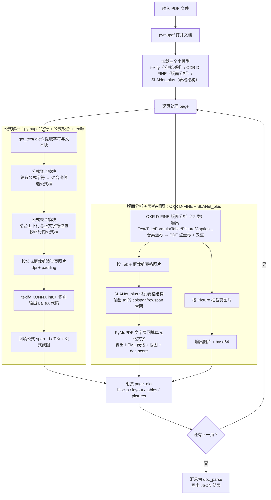

## pdf 本地解析

### 解析模块

解析模块使用pymupdf和三个小模型构成整个解析流程。

对于公式，由于小模型检测行内公式的能力有限，所以本解析模块根据 pymupdf 解析出的公式字符的位置进行聚合得到行内公式的公式框，再根据其与正文字符的位置关系对行内公式框进行修正，得到最终的公式框，实现上述功能的模块称为公式聚合模块。公式聚合模块相较于使用检测模型来说，能够保证不会遗漏行内公式。之后根据公式框裁剪公式图片，使用识别模型转为latex公式代码。

对于图片和表格，使用 OXR 的 D-FINE 版面分析模型（`models/oxr_layout_analysis/`，12 类区域检测）定位表格框，之后使用 SLANet_plus 模型将裁剪的表格图片转化为 html 表格。（原 YOLOv13 检测器已被该版面模型取代。）



### 模型下载

```bash
bash download.sh
```

### 依赖安装

1. 安装依赖（`utils/dfine_la` 版面模型需要 `opencv-python-headless`）
   ```bash
   pip install -r requirements.txt
   ```
   > 公式识别已改为 `models/texify-quantized-onnx`（ONNX Runtime + int8 量化权重），
   > 只需要 `onnxruntime` + `tokenizers`；**不要**再安装 `texify` / `transformers`，
   > 也不需要 `models/texify` 的 torch 权重。
2. （可选，已不再需要）旧的 YOLOv13 检测器目录 `yolov13/` 保留用于历史版本，
   当前 pipeline 不再 import 它。